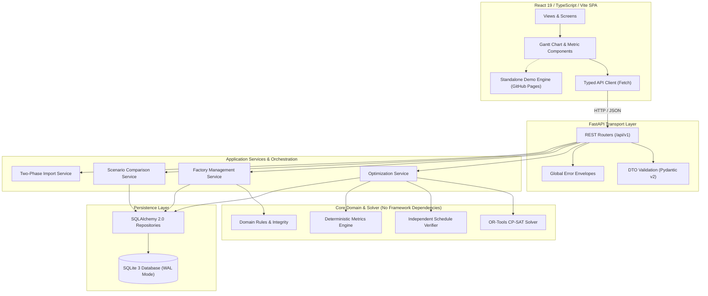

# Opwise — Architecture, Repository Structure, and Component Blueprint

- **Document ID:** OPW-ARC-001
- **Status:** APPROVED FOR SPECIFICATION (Phase 0.3 Pre-Implementation Approval Gate)
- **Version:** 1.3.0
- **Last Updated:** 2026-10-16
- **Governance:** Governed by `PROJECT_RULES.md` (Opwise Permanent Constitution)
- **Architecture Pattern:** Clean / Hexagonal Architecture with Strict Unidirectional Dependencies

---

## 1. Monorepo Repository Structure & Evaluation

### 1.1 Structural Evaluation: Pragmatic Monorepo vs. Package Sprawl
During Phase 0.3, a deeply nested enterprise package structure (e.g. `apps/web/`, `apps/api/`, `packages/core/`, `packages/solver/`, `packages/verifier/`) was evaluated against a pragmatic two-tier monorepo (`backend/`, `frontend/`, `.github/`).

**Decision:** Opwise adopts the **Pragmatic Two-Tier Monorepo Structure**.
- **Rationale:** Deeply nested multi-package workspaces introduce substantial tooling complexity (e.g. `pnpm-workspace.yaml`, Turborepo, Poetry path dependencies, multi-package lockfiles, and fragile cross-package symlinks on Windows) without providing architectural isolation beyond what clean Python modules and TypeScript path aliases provide.
- **Enforcement:** Architectural isolation between domain, solver, verifier, persistence, and API is strictly enforced via Python module boundary linters (`import-linter` / flake8-tidy-imports) and TypeScript path boundaries, avoiding unnecessary monorepo build overhead.

### 1.2 Target Directory Tree

```
Opwise/
├── README.md                          # Project overview, quickstart & portfolio index
├── PROJECT_RULES.md                   # Permanent project constitution & non-negotiable rules
├── SPECIFICATION.md                   # Complete product and functional specification
├── ARCHITECTURE.md                    # Architecture, topology & component blueprint
├── SOLVER_MODEL.md                    # CP-SAT mathematical model & verification specification
├── DATA_AND_API.md                    # Data persistence, schemas & REST API specification
├── TEST_AND_RELEASE_PLAN.md           # Test matrix, delivery milestones & release gates
├── DECISIONS.md                       # Architecture Decision Records (ADRs 001–012)
│
├── backend/
│   ├── pyproject.toml
│   ├── requirements.txt
│   ├── requirements-dev.txt
│   ├── .env.example
│   ├── alembic.ini
│   ├── alembic/
│   │   ├── env.py
│   │   ├── script.py.mako
│   │   └── versions/
│   │       └── 001_initial_schema.py
│   │
│   ├── opwise/
│   │   ├── __init__.py
│   │   ├── main.py                    # Application entrypoint & FastAPI factory
│   │   ├── config.py                  # Pydantic Settings & environment config
│   │   │
│   │   ├── domain/                    # Pure Domain Core (Zero external deps)
│   │   │   ├── __init__.py
│   │   │   ├── entities.py            # Domain models (Order, Machine, Operation)
│   │   │   ├── exceptions.py          # Domain-level exception hierarchy
│   │   │   ├── validators.py          # Input validation, empty/no-work detection, downtime normalization
│   │   │   └── metrics.py             # Deterministic metrics & explanation math
│   │   │
│   │   ├── solver/                    # Optimization Engine
│   │   │   ├── __init__.py
│   │   │   ├── cp_sat_model.py        # CP-SAT formulation, variables, constraints
│   │   │   ├── multi_objective.py     # Hierarchical lexicographic strategy with optimality gating
│   │   │   └── solver_types.py        # Solver telemetry & result dataclasses
│   │   │
│   │   ├── verifier/                  # Independent Schedule Auditor
│   │   │   ├── __init__.py
│   │   │   ├── schedule_verifier.py   # 8-invariant clean-room verifier
│   │   │   └── verification_types.py  # Audit reports & violation records
│   │   │
│   │   ├── persistence/               # Database & Repositories
│   │   │   ├── __init__.py
│   │   │   ├── database.py            # SQLite engine, WAL pragmas & connection listeners
│   │   │   ├── models.py              # SQLAlchemy 2.0 ORM mapping
│   │   │   └── repository.py          # Atomic CRUD & workspace isolation queries
│   │   │
│   │   ├── io/                        # Data Exchange & Import/Export
│   │   │   ├── __init__.py
│   │   │   ├── csv_parser.py          # Strict CSV parsing & validation
│   │   │   ├── excel_parser.py        # OpenPyXL multi-sheet processor
│   │   │   └── exporters.py           # Schedule CSV/Excel generation
│   │   │
│   │   ├── api/                       # HTTP Transport Layer
│   │   │   ├── __init__.py
│   │   │   ├── dependencies.py        # DB session & service dependency injection
│   │   │   ├── error_handlers.py      # Global exception translation to envelopes
│   │   │   ├── schemas/               # Pydantic v2 Request/Response DTOs
│   │   │   │   ├── common.py
│   │   │   │   ├── factory.py
│   │   │   │   ├── schedule.py
│   │   │   │   └── scenario.py
│   │   │   └── routers/               # Versioned REST endpoints
│   │   │       ├── __init__.py
│   │   │       ├── health.py
│   │   │       ├── demos.py
│   │   │       ├── workspaces.py
│   │   │       ├── factory.py
│   │   │       ├── optimization.py
│   │   │       ├── schedules.py
│   │   │       ├── scenarios.py
│   │   │       └── data_exchange.py
│   │   │
│   │   └── demos/                     # Pre-packaged Synthetic Datasets
│   │       ├── __init__.py
│   │       ├── demo_registry.py
│   │       └── data/                  # 6 Synthetic benchmark scenarios
│   │           ├── demo_1_normal.json
│   │           ├── demo_2_bottleneck.json
│   │           ├── demo_3_high_load.json
│   │           ├── demo_4_urgent_order.json
│   │           ├── demo_5_downtime.json
│   │           └── demo_6_invalid_input.json
│   │
│   └── tests/                         # Pytest Suite
│       ├── conftest.py
│       ├── unit/
│       │   ├── test_domain_validators.py
│       │   ├── test_metrics_calculations.py
│       │   ├── test_verifier_clean_room.py
│       │   └── test_csv_excel_parsers.py
│       ├── solver/
│       │   ├── test_cp_sat_correctness.py
│       │   ├── test_lexicographic_solve.py
│       │   └── test_infeasible_scenarios.py
│       └── integration/
│           ├── test_sqlite_wal_transactions.py
│           ├── test_api_endpoints.py
│           └── test_scenario_branching.py
│
├── frontend/
│   ├── package.json
│   ├── package-lock.json
│   ├── tsconfig.json
│   ├── tsconfig.node.json
│   ├── vite.config.ts
│   ├── index.html
│   │
│   ├── src/
│   │   ├── main.tsx                   # React root mount
│   │   ├── App.tsx                    # Top-level routing & layout shell
│   │   ├── index.css                  # Tailwind styles & theme variables
│   │   │
│   │   ├── types/                     # Shared TypeScript contracts matching API DTOs
│   │   │   ├── domain.ts
│   │   │   ├── schedule.ts
│   │   │   ├── scenario.ts
│   │   │   └── api.ts
│   │   │
│   │   ├── api/                       # Typed HTTP Client
│   │   │   ├── client.ts              # Axios or native fetch wrapper
│   │   │   └── endpoints.ts           # Typed API service calls
│   │   │
│   │   ├── hooks/                     # Custom React Hooks
│   │   │   ├── useWorkspace.ts
│   │   │   ├── useFactoryData.ts
│   │   │   ├── useSchedule.ts
│   │   │   └── useGanttZoom.ts
│   │   │
│   │   ├── components/                # UI Component Library
│   │   │   ├── common/                # Primitives (Button, Modal, Toast, Badge)
│   │   │   ├── layout/                # Header, Sidebar, WorkspaceSwitcher
│   │   │   ├── factory/               # MachineTable, OrderTable, OperationEditor
│   │   │   ├── gantt/                 # SVG/Canvas Interactive Gantt Chart
│   │   │   │   ├── GanttChart.tsx
│   │   │   │   ├── GanttHeaderTimeAxis.tsx
│   │   │   │   ├── GanttMachineRow.tsx
│   │   │   │   ├── GanttOperationBlock.tsx
│   │   │   │   ├── GanttDowntimeOverlay.tsx
│   │   │   │   └── GanttTooltip.tsx
│   │   │   ├── metrics/               # MetricCards, BottleneckBanner, TradeoffView
│   │   │   ├── scenarios/             # DisruptionLab, ScenarioComparator, DiffView
│   │   │   └── io/                    # ImportModal, PreviewTable, ExportDropdown
│   │   │
│   │   ├── demo/                      # Standalone Client-Side Demo Mode (Static Portfolio Demo)
│   │   │   ├── clientVerifier.ts      # Pure TypeScript 8-invariant verifier (clean-room in browser)
│   │   │   ├── demoService.ts         # Mocked client-side API provider for GitHub Pages
│   │   │   └── fixtures/              # Pre-solved synthetic scenarios (Demos 1–6)
│   │   │       ├── demo1_baseline.json
│   │   │       ├── demo2_disrupted.json
│   │   │       └── ...
│   │   │
│   │   └── views/                     # Page Views
│   │       ├── WorkspaceSelectView.tsx
│   │       ├── FactoryPlannerView.tsx
│   │       ├── ScheduleDetailView.tsx
│   │       ├── ScenarioLabView.tsx
│   │       └── HistoryView.tsx
│   │
│   └── tests/                         # Vitest & RTL Frontend Suite
│       ├── setup.ts
│       ├── components/
│       │   ├── GanttChart.test.tsx
│       │   ├── MetricCards.test.tsx
│       │   └── ImportPreview.test.tsx
│       └── views/
│           └── FactoryPlannerView.test.tsx
│
└── .github/
    └── workflows/
        ├── ci.yml                     # Multi-OS test & build verification (Lint, Test, Typecheck)
        └── deploy-demo.yml            # Static frontend build & deployment to GitHub Pages
```

---

## 2. Component Blueprint & Dependency Flow



### 2.1 Architectural Invariant Rules
1. **Zero Upward Dependencies:** Core Domain modules (`domain/`, `solver/`, `verifier/`) must never import from `api/`, `persistence/`, or web frameworks. They are pure Python components that operate strictly on domain models.
2. **Decoupled Verifier:** The `ScheduleVerifier` must not import or reference Google OR-Tools. It operates strictly on output start/end timestamps and domain inputs using pure analytical Python math.
3. **Pydantic DTO Separation:** API Pydantic schemas in `api/schemas/` are decoupled from SQLAlchemy ORM entities in `persistence/models.py`. Direct exposure of ORM models via API routes is strictly forbidden.
4. **Single-Transaction Service Calls:** Services manage transaction boundaries using `with session.begin():`. A single service method executes within an atomic database transaction.
5. **Per-Connection SQLite Configuration:** Foreign key constraints are enforced on every SQLite connection via an engine listener (`PRAGMA foreign_keys = ON;`). WAL mode with `PRAGMA synchronous = NORMAL;` is configured to balance high write performance with process crash safety.
6. **Strict ₹0 Operating Budget (`PROJECT_RULES.md` Rule 1):** Zero paid external APIs, zero remote LLMs or chatbots. All optimization runs locally on Google OR-Tools CP-SAT.
7. **Clean Verification Autonomy (`PROJECT_RULES.md` Rule 6):** An unverified schedule is never marked optimal. The independent verifier must pass all 8 invariants before any schedule is marked `VERIFIED`.
8. **Immutable Scenario Baselines (`SPECIFICATION.md` Section 3.2):** Baselines cannot be mutated by disruption simulations; simulation results are cloned into distinct scenario entities.

---

## 3. Deployment Topology, Runtime Constraints, and Hosting Architecture

### 3.1 Tiered Deployment Topology
Opwise enforces Non-Negotiable Rules 1 and 2 (`PROJECT_RULES.md`) by adopting a three-tier deployment strategy:

```
+----------------------------------------------------------------------------------------------------+
| TIER 1: PRIMARY DEVELOPMENT & PRODUCTION (Canonical Local Engine)                                  |
| Architecture: Full FastAPI Backend + SQLite 3 WAL + OR-Tools CP-SAT (9.15+) + React 19 Frontend    |
| Host: Localhost (127.0.0.1:8000 & localhost:5173). Zero external network touchpoints.             |
| Capabilities: Full live multi-threaded CP-SAT optimization, arbitrary job shop size, custom       |
|               disruption simulation, persistent SQLite WAL storage, Excel/CSV round-trip I/O.     |
+----------------------------------------------------------------------------------------------------+
                                                   |
                                                   v
+----------------------------------------------------------------------------------------------------+
| TIER 2: PUBLIC PORTFOLIO DEMONSTRATION (Static GitHub Pages Web App)                               |
| Architecture: React 19 SPA running in "Standalone Client-Side Demo Mode"                          |
| Host: GitHub Pages (Permanent ₹0 hosting, zero credit card, 100GB/mo CDN bandwidth).              |
| Engine: Pre-solved synthetic schedule fixtures (Demo Scenarios 1–6) + TypeScript Clean Verifier.   |
| Capabilities: Interactive Gantt exploration (zoom, hover, machine filter), scenario comparison,    |
|               live client-side verification of all 8 invariants, CSV export.                       |
| Notice Banner: "Interactive Static Portfolio Demo — Pre-solved synthetic scenarios loaded in      |
|                client-side simulation. Run locally for custom CP-SAT solving and re-optimization." |
+----------------------------------------------------------------------------------------------------+
                                                   |
                                                   v
+----------------------------------------------------------------------------------------------------+
| TIER 3: PORTABLE REVIEWER RUNNER (Containerized / Scripted Execution)                              |
| Architecture: Standard Docker Compose (`docker compose up`) or native batch runner (`run_local.bat`)|
| Capabilities: Allows external technical reviewers to launch the complete Tier 1 engine locally     |
|               with a single command, without manual environment configuration.                     |
+----------------------------------------------------------------------------------------------------+
```

### 3.2 Evaluation of Hosting Providers & Runtime Constraints

| Provider | Python Backend? | Persistent SQLite? | Cold Start / Quotas | Cost & Safety Assessment |
| :--- | :---: | :---: | :--- | :--- |
| **GitHub Pages** | NO | NO | None (Static CDN) | **APPROVED for Tier 2 Demo.** Permanent ₹0 cost, zero credit card, rock-solid uptime. |
| **Vercel Free** | Severely Limited | NO | 10s timeout; 50MB function size limit | **REJECTED for Backend.** CP-SAT C++ wheel exceeds bundle limit; ephemeral disk destroys SQLite. |
| **Render Free** | YES | NO | 15 min idle spin-down; 50s cold start; 512MB RAM | **REJECTED for Backend.** Inactivity cold starts ruin user experience; 512MB RAM risks OOM on CP-SAT. |
| **Railway** | YES | Paid Volume Only | Requires credit card; $5 trial then billed | **REJECTED.** Violates strict ₹0 budget and zero-credit-card mandate. |
| **PythonAnywhere** | Restricted | YES | 100 CPU-seconds/day; no async loop | **REJECTED.** Throttles compute; incompatible with modern asynchronous FastAPI stack. |
| **Localhost / Docker** | YES (Full) | YES (Full WAL) | None (Native hardware speed) | **APPROVED for Tier 1 & 3.** Unrestricted compute, durable storage, 100% offline reliability. |

---

## 4. Contributor Code Navigation Guide ("Where Do I Find...?")

To ensure the codebase is easily navigable and maintainable by any engineer (`PROJECT_RULES.md` Rule 4), every functional capability maps to an unambiguous module location:

| Development Task / Responsibility | Target File / Directory Location |
| :--- | :--- |
| **Add a new domain entity or dataclass** | `backend/opwise/domain/entities.py` |
| **Add an input validation rule or check** | `backend/opwise/domain/validators.py` |
| **Modify machine downtime merge normalization** | `backend/opwise/domain/validators.py` (`normalize_downtimes`) |
| **Add or update an optimization objective** | `backend/opwise/solver/cp_sat_model.py` (`build_objective`) |
| **Add or modify CP-SAT scheduling constraints** | `backend/opwise/solver/cp_sat_model.py` (`build_constraints`) |
| **Adjust multi-stage lexicographic solve logic** | `backend/opwise/solver/multi_objective.py` |
| **Translate CP-SAT solver status to API response**| `backend/opwise/solver/solver_types.py` (`map_solver_status`) |
| **Update clean-room independent verifier rules** | `backend/opwise/verifier/schedule_verifier.py` |
| **Modify KPI metrics (makespan, tardiness, util)**| `backend/opwise/domain/metrics.py` |
| **Add or modify scenario disruption models** | `backend/opwise/domain/entities.py` & `solver/multi_objective.py` |
| **Configure SQLite WAL pragmas and connection hooks**| `backend/opwise/persistence/database.py` |
| **Add or alter SQLAlchemy database schema entities**| `backend/opwise/persistence/models.py` |
| **Add or modify a REST API endpoint** | `backend/opwise/api/routes/` (`optimization.py`, `workspaces.py`) |
| **Update Pydantic API request/response DTOs** | `backend/opwise/api/schemas/` |
| **Modify Excel (.xlsx) or CSV import/export** | `backend/opwise/io/` (`excel_parser.py`, `csv_parser.py`) |
| **Update interactive Gantt SVG/Canvas rendering** | `frontend/src/components/gantt/GanttChart.tsx` |
| **Modify Gantt timeline coordinate transform math**| `frontend/src/components/gantt/GanttOperationBlock.tsx` |
| **Update client-side demo fixtures or verifier**| `frontend/src/demo/` (`fixtures/`, `clientVerifier.ts`) |
| **Add backend unit or integration tests** | `backend/tests/` (`test_solver.py`, `test_verifier.py`) |
| **Add frontend component or view tests** | `frontend/tests/` (`GanttChart.test.tsx`, `views/`) |

---

## 5. Configuration and Environment Management

Configuration uses `pydantic-settings` to parse environment variables with type validation and local fallback defaults.

```python
# backend/opwise/config.py
from pydantic_settings import BaseSettings
from pydantic import Field

class Settings(BaseSettings):
    app_name: str = "Opwise Production Scheduler"
    environment: str = Field(default="development")
    api_prefix: str = "/api/v1"
    
    # Persistence
    database_url: str = Field(default="sqlite:///./opwise.sqlite3")
    db_echo: bool = Field(default=False)
    db_synchronous: str = Field(default="NORMAL")  # NORMAL (default) or FULL for extreme power-loss durability
    
    # Solver Defaults
    default_max_time_seconds: float = Field(default=15.0)
    max_allowed_time_seconds: float = Field(default=60.0)
    solver_num_workers: int = Field(default=1)  # 1 for deterministic reproducibility
    default_random_seed: int = Field(default=42)
    
    # Limits
    max_horizon_minutes: int = Field(default=10_000_000)
    max_operations_per_order: int = Field(default=100)
    max_orders_per_workspace: int = Field(default=1000)
    
    class Config:
        env_file = ".env"
        env_file_encoding = "utf-8"
```

---

## 6. Structured Logging and Error Handling

### 6.1 Logging Architecture
- Opwise uses structured standard library logging configured to output JSON in production or colored human-readable text in development.
- Every HTTP request receives a unique `request_id` (via ASGI middleware), injected into log records for distributed tracing across logs.
- Dedicated logger `opwise.solver` captures:
  - Solver parameter configurations.
  - Wall-clock and deterministic execution ticks.
  - Number of integer variables and constraints generated.
  - Independent verifier audit outcome (passed checks, violations).

### 6.2 Hierarchical Domain Exceptions
All internal errors inherit from `OpwiseError`:
```
OpwiseError
├── DomainError
│   ├── ValidationError (HTTP 422)
│   ├── ReferentialIntegrityError (HTTP 422)
│   ├── CircularPrecedenceError (HTTP 422)
│   └── IntegerOverflowError (HTTP 422)
├── SolverError
│   ├── ModelInvalidError (HTTP 500)
│   ├── InfeasibleModelError (HTTP 422)
│   └── OptimizationTimeoutError (HTTP 504)
├── VerificationError
│   └── InvariantViolationError (HTTP 422 / 500)
└── PersistenceError
    ├── WorkspaceNotFoundError (HTTP 404)
    ├── ScheduleNotFoundError (HTTP 404)
    └── DatabaseLockError (HTTP 503)
```

---

## 7. Proposed Developer, Build, and Startup Commands

> **CRITICAL NOTE:** The following commands are proposed development scripts for Phase 1. In strict compliance with the Phase 0 scope boundary, these commands have **not** been executed, no virtual environment has been created, no dependencies have been installed, and no application files have been initialized.

### 7.1 Backend (Proposed)
```bash
# Navigate to backend directory
cd backend

# Create virtual environment (Python 3.12)
python -m venv .venv
source .venv/bin/activate  # Windows: .venv\Scripts\activate

# Install dependencies from pinned requirements
pip install -r requirements.txt -r requirements-dev.txt

# Run database migrations
alembic upgrade head

# Start local development server with auto-reload
uvicorn opwise.main:app --host 127.0.0.1 --port 8000 --reload

# Run test suite with coverage
pytest tests/ -v --cov=opwise
```

### 7.2 Frontend (Proposed)
```bash
# Navigate to frontend directory
cd frontend

# Install node dependencies
npm ci

# Start local Vite development server
npm run dev

# Run unit and component tests
npm run test

# Compile production bundle for local backend
npm run build
```

### 7.3 Static Portfolio Demo Build & Preview (Proposed)
```bash
# Compile static demo bundle for GitHub Pages (Tier 2)
cd frontend
npm run build:demo

# Locally preview the static demo build
npm run preview
```

### 7.4 Portable Reviewer Runner (Docker Compose - Proposed)
```bash
# Launch entire stack locally via containerized runner (Tier 3)
docker compose up --build
```

