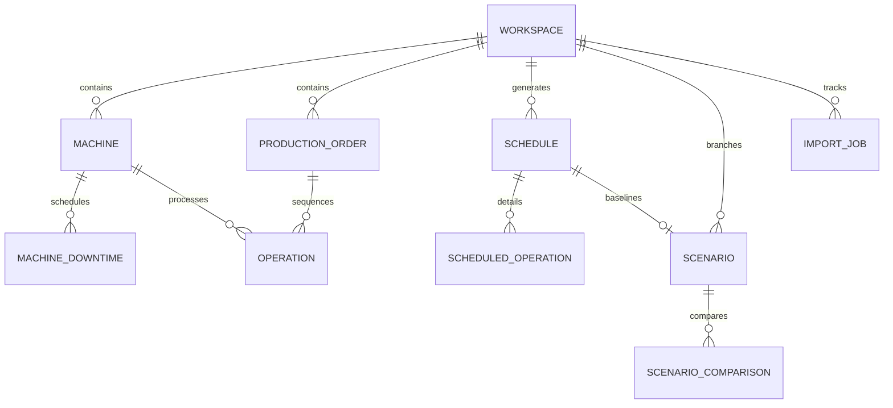

# Opwise — Data Architecture, Persistence, and REST API Specification

- **Document ID:** OPW-DAT-001
- **Status:** APPROVED FOR SPECIFICATION (Phase 0.3 Pre-Implementation Approval Gate)
- **Version:** 1.3.0
- **Last Updated:** 2026-10-16
- **Governance:** Governed by `PROJECT_RULES.md` (Opwise Permanent Constitution)
- **Architecture:** Local-first SQLite with SQLAlchemy 2.0, Alembic migrations, and OpenAPI 3.1 REST API

---

## 1. Entity-Relationship Data Model

Opwise enforces strict relational integrity, workspace isolation, and immutable schedule snapshots.



### 1.1 Entity Definitions & Schema Specifications

#### 1. Workspace (`workspaces`)
Root tenant boundary for multi-scenario planning. All operational entities belong to exactly one workspace.
- `id` (VARCHAR(36), PK): UUIDv4 string.
- `name` (VARCHAR(128), NOT NULL): Human-readable workspace name.
- `description` (TEXT, NULLABLE): Optional notes.
- `created_at` (TIMESTAMP, NOT NULL, DEFAULT UTC): Creation timestamp.
- `updated_at` (TIMESTAMP, NOT NULL, DEFAULT UTC): Last modified timestamp.
- **Constraints:** UNIQUE(`name`).

#### 2. Machine (`machines`)
Physical production resource.
- `id` (VARCHAR(36), PK): UUIDv4 string.
- `workspace_id` (VARCHAR(36), NOT NULL, FK -> `workspaces.id` ON DELETE CASCADE).
- `external_id` (VARCHAR(64), NOT NULL): Business/user identifier (e.g., "M1", "CNC-01").
- `name` (VARCHAR(128), NOT NULL): Descriptive name.
- `created_at` (TIMESTAMP, NOT NULL, DEFAULT UTC).
- **Constraints:** UNIQUE(`workspace_id`, `external_id`).
- **Indexes:** INDEX(`workspace_id`).

#### 3. Machine Downtime (`machine_downtimes`)
Planned maintenance or outage window during which the machine is unavailable.
- `id` (VARCHAR(36), PK): UUIDv4 string.
- `machine_id` (VARCHAR(36), NOT NULL, FK -> `machines.id` ON DELETE CASCADE).
- `start_minute` (INTEGER, NOT NULL): Half-open window start ($t \ge 0$).
- `end_minute` (INTEGER, NOT NULL): Half-open window end ($t > \text{start\_minute}$).
- `reason` (VARCHAR(255), NULLABLE): Maintenance reason.
- **Constraints:** CHECK(`start_minute` >= 0), CHECK(`end_minute` > `start_minute`).
- **Indexes:** INDEX(`machine_id`, `start_minute`).

#### 4. Production Order (`production_orders`)
Customer or replenishment job requiring a sequence of operations.
- `id` (VARCHAR(36), PK): UUIDv4 string.
- `workspace_id` (VARCHAR(36), NOT NULL, FK -> `workspaces.id` ON DELETE CASCADE).
- `external_id` (VARCHAR(64), NOT NULL): Order number (e.g., "ORD-101").
- `name` (VARCHAR(128), NOT NULL): Product or order name.
- `release_minute` (INTEGER, NOT NULL, DEFAULT 0): Earliest allowed start ($r_j \ge 0$).
- `due_minute` (INTEGER, NOT NULL): Soft target delivery minute ($d_j \ge 0$).
- `tardiness_weight` (INTEGER, NOT NULL, DEFAULT 1): Weight penalty per minute late ($w_j \ge 0$).
- `created_at` (TIMESTAMP, NOT NULL, DEFAULT UTC).
- **Constraints:** UNIQUE(`workspace_id`, `external_id`), CHECK(`release_minute` >= 0), CHECK(`due_minute` >= 0), CHECK(`tardiness_weight` >= 0).
- **Indexes:** INDEX(`workspace_id`).

#### 5. Operation (`operations`)
Atomic task belonging to a specific order, processed by a specific machine.
- `id` (VARCHAR(36), PK): UUIDv4 string.
- `order_id` (VARCHAR(36), NOT NULL, FK -> `production_orders.id` ON DELETE CASCADE).
- `sequence_index` (INTEGER, NOT NULL): 1-based sequential step within order ($1, 2, \dots, n_j$).
- `machine_id` (VARCHAR(36), NOT NULL, FK -> `machines.id` ON DELETE RESTRICT).
- `processing_minutes` (INTEGER, NOT NULL): Duration ($p_{j,k} \ge 1$).
- **Constraints:** UNIQUE(`order_id`, `sequence_index`), CHECK(`sequence_index` >= 1), CHECK(`processing_minutes` >= 1).
- **Indexes:** INDEX(`order_id`), INDEX(`machine_id`).

#### 6. Schedule (`schedules`)
Immutable optimization solution snapshot generated by the solver or analytical no-work evaluator.
- `id` (VARCHAR(36), PK): UUIDv4 string.
- `workspace_id` (VARCHAR(36), NOT NULL, FK -> `workspaces.id` ON DELETE CASCADE).
- `name` (VARCHAR(128), NOT NULL): Schedule label (e.g., "Baseline 2026-10-16").
- `objective_type` (VARCHAR(32), NOT NULL): `MAKESPAN` | `WEIGHTED_TARDINESS` | `HIERARCHICAL` | `NONE`.
- `solver_status` (VARCHAR(32), NOT NULL): `OPTIMAL` | `FEASIBLE` | `INFEASIBLE` | `UNKNOWN` | `MODEL_INVALID` | `NO_WORK_STATE`.
- `verification_status` (VARCHAR(32), NOT NULL): `VERIFIED` | `VERIFICATION_FAILED` | `SKIPPED`.
- `objective_value` (INTEGER, NULLABLE): Metric value achieved.
- `best_objective_bound` (INTEGER, NULLABLE): Mathematical bound from CP-SAT.
- `optimality_gap` (FLOAT, NULLABLE): Gap fraction.
- `stage1_status` (VARCHAR(32), NULLABLE): Status of Stage 1 if hierarchical.
- `stage1_objective_value` (INTEGER, NULLABLE): Objective value of Stage 1.
- `stage1_best_bound` (INTEGER, NULLABLE): Best bound of Stage 1.
- `stage1_wall_clock_seconds` (FLOAT, NULLABLE): Solve time for Stage 1.
- `stage2_status` (VARCHAR(32), NULLABLE): Status of Stage 2 if hierarchical.
- `stage2_objective_value` (INTEGER, NULLABLE): Objective value of Stage 2.
- `stage2_best_bound` (INTEGER, NULLABLE): Best bound of Stage 2.
- `stage2_wall_clock_seconds` (FLOAT, NULLABLE): Solve time for Stage 2.
- `makespan_minutes` (INTEGER, NOT NULL): Computed schedule makespan ($C_{\max} = \max C_{j,k} - 0$).
- `weighted_tardiness` (INTEGER, NOT NULL): Total weighted tardiness ($\sum w_j T_j$).
- `late_order_count` (INTEGER, NOT NULL): Count of orders with $T_j > 0$.
- `on_time_rate` (FLOAT, NOT NULL): Percentage of orders on-time ($T_j = 0$).
- `solver_wall_clock_seconds` (FLOAT, NOT NULL): Total solve time.
- `solver_deterministic_time` (FLOAT, NULLABLE): Deterministic ticks.
- `input_snapshot_json` (TEXT, NOT NULL): Serialized JSON of all orders, operations, and machines used to produce this schedule.
- `created_at` (TIMESTAMP, NOT NULL, DEFAULT UTC).
- **Indexes:** INDEX(`workspace_id`, `created_at`).

#### 7. Scheduled Operation (`scheduled_operations`)
Individual timestamp allocation of an operation on a machine.
- `id` (VARCHAR(36), PK): UUIDv4 string.
- `schedule_id` (VARCHAR(36), NOT NULL, FK -> `schedules.id` ON DELETE CASCADE).
- `operation_id` (VARCHAR(36), NOT NULL): Reference to operation ID.
- `order_id` (VARCHAR(36), NOT NULL): Reference to order ID.
- `machine_id` (VARCHAR(36), NOT NULL): Reference to machine ID.
- `start_minute` (INTEGER, NOT NULL): Allocated start minute ($S_{j,k} \ge 0$).
- `end_minute` (INTEGER, NOT NULL): Allocated completion minute ($C_{j,k} = S_{j,k} + p_{j,k}$).
- **Constraints:** CHECK(`start_minute` >= 0), CHECK(`end_minute` > `start_minute`).
- **Indexes:** INDEX(`schedule_id`, `machine_id`, `start_minute`), INDEX(`schedule_id`, `order_id`).

#### 8. Scenario (`scenarios`)
A branch from a baseline schedule used to evaluate disruptions as offline planning simulations.
- `id` (VARCHAR(36), PK): UUIDv4 string.
- `workspace_id` (VARCHAR(36), NOT NULL, FK -> `workspaces.id` ON DELETE CASCADE).
- `baseline_schedule_id` (VARCHAR(36), NOT NULL, FK -> `schedules.id` ON DELETE RESTRICT).
- `reoptimized_schedule_id` (VARCHAR(36), NULLABLE, FK -> `schedules.id` ON DELETE SET NULL).
- `name` (VARCHAR(128), NOT NULL): Scenario name (e.g., "M1 Breakdown Experiment").
- `description` (TEXT, NULLABLE).
- `disruption_type` (VARCHAR(32), NOT NULL): `MACHINE_DOWNTIME` | `URGENT_ORDER` | `COMBINED`.
- `disruption_delta_json` (TEXT, NOT NULL): Serialized payload specifying added downtime windows or inserted orders.
- `created_at` (TIMESTAMP, NOT NULL, DEFAULT UTC).
- **Indexes:** INDEX(`workspace_id`), INDEX(`baseline_schedule_id`).

#### 9. Scenario Comparison (`scenario_comparisons`)
Computed differences between a baseline schedule and a reoptimized scenario schedule.
- `id` (VARCHAR(36), PK): UUIDv4 string.
- `scenario_id` (VARCHAR(36), NOT NULL, FK -> `scenarios.id` ON DELETE CASCADE).
- `baseline_schedule_id` (VARCHAR(36), NOT NULL, FK -> `schedules.id` ON DELETE CASCADE).
- `compared_schedule_id` (VARCHAR(36), NOT NULL, FK -> `schedules.id` ON DELETE CASCADE).
- `delta_makespan` (INTEGER, NOT NULL): Compared makespan minus Baseline makespan.
- `delta_weighted_tardiness` (INTEGER, NOT NULL): Compared tardiness minus Baseline tardiness.
- `delta_late_order_count` (INTEGER, NOT NULL): Compared late count minus Baseline late count.
- `objective_diff_detected` (BOOLEAN, NOT NULL): True if baseline and scenario used different objectives.
- `order_set_diff_detected` (BOOLEAN, NOT NULL): True if order count or order IDs differ.
- `status_diff_detected` (BOOLEAN, NOT NULL): True if solver status differed (e.g. OPTIMAL vs FEASIBLE).
- `time_limit_diff_detected` (BOOLEAN, NOT NULL): True if solver time limits differed.
- `unlike_comparison_warning` (TEXT, NULLABLE): Explicit warning text if comparing unlike instances.
- `critical_path_divergence_json` (TEXT, NOT NULL): Summary of operations displaced or delayed.
- `created_at` (TIMESTAMP, NOT NULL, DEFAULT UTC).

#### 10. Import Job (`import_jobs`)
Tracking entity for batch CSV/Excel import operations.
- `id` (VARCHAR(36), PK): UUIDv4 string.
- `workspace_id` (VARCHAR(36), NOT NULL, FK -> `workspaces.id` ON DELETE CASCADE).
- `filename` (VARCHAR(255), NOT NULL).
- `status` (VARCHAR(32), NOT NULL): `PENDING_CONFIRMATION` | `COMMITTED` | `FAILED` | `CANCELLED`.
- `staged_data_json` (TEXT, NOT NULL): Validated staged rows waiting for user confirmation.
- `error_report_json` (TEXT, NULLABLE): Detailed row-by-row parse and referential errors.
- `created_at` (TIMESTAMP, NOT NULL, DEFAULT UTC).

---

## 2. Persistence Architecture and SQLite WAL Durability

### 2.1 SQLite Configuration & Connection Pragmas

Every SQLite connection executes connection pragmas via SQLAlchemy event hooks:
```python
# opwise/persistence/database.py
from sqlalchemy import create_engine, event
from sqlalchemy.engine import Engine

engine = create_engine(
    "sqlite:///./opwise.sqlite3",
    connect_args={"timeout": 15}
)

@event.listens_for(Engine, "connect")
def set_sqlite_pragmas(dbapi_connection, connection_record):
    cursor = dbapi_connection.cursor()
    cursor.execute("PRAGMA journal_mode = WAL;")
    cursor.execute("PRAGMA busy_timeout = 5000;")
    cursor.execute("PRAGMA foreign_keys = ON;")
    cursor.execute("PRAGMA synchronous = NORMAL;")
    cursor.execute("PRAGMA cache_size = -64000;")  # 64MB cache
    cursor.close()
```

#### Durability & Performance Trade-Off
- `PRAGMA synchronous = NORMAL;`: Flushes WAL to disk during checkpoints. Protects against database corruption upon application crash, OS crash, or process kill. In the event of sudden physical power loss before a checkpoint, the most recent uncheckpointed transactions might be rolled back.
- If physical power-loss durability is required, `PRAGMA synchronous = FULL;` can be configured via environment settings (`DB_SYNCHRONOUS=FULL`), trading off write throughput for immediate disk `fsync` on every commit.

### 2.2 Transaction Boundaries and Rollback Discipline
1. **Service Layer Ownership:** Multi-record operations execute in an atomic service-managed transaction (`with session.begin():`). Repositories accept active sessions and do not call `commit()`.
2. **Safe Backup & Restoration under WAL:** Naively copying `opwise.sqlite3` with OS file utilities while the database is open risks copying a torn state. Mandated backup procedure uses `VACUUM INTO 'backup_filepath.sqlite3';` or SQLite’s Online Backup API.
3. **Database Migration Failures:** Alembic manages schema versioning with transactional DDL. Startup verifies `alembic_version` matches the expected head; mismatch halts boot with clear diagnostics.
4. **Failure Realism:** Software process-kill tests verify OS cleanup and SQLite WAL rollback; they do not test sudden physical drive power loss.

### 2.3 Local-First Zero-Cost Persistence & Separation from Git Backups
1. **Strict ₹0 Persistence:** Persistence uses purely local SQLite files residing on the user's host filesystem (`./opwise.sqlite3`). No cloud-hosted SQL or remote databases are permitted (`PROJECT_RULES.md` Rule 1).
2. **Total Data Privacy:** Production orders, machine capacities, and due dates remain 100% on the local workstation. Zero telemetry, analytical beacons, or cloud synchronization calls exist.
3. **Git Backup Decoupling:** Runtime database files (`*.sqlite3`, `*.sqlite3-wal`, `*.sqlite3-shm`) are strictly excluded from source control via `.gitignore`. Disaster recovery of the codebase is managed via GitHub remote commits; disaster recovery of local user data is managed separately via local `VACUUM INTO` snapshots.

---

## 3. REST API Contract (`/api/v1`)

All endpoints are versioned under `/api/v1`.

### 3.1 Standard Response Envelopes

#### Success Envelope
```json
{
  "success": true,
  "data": { ... },
  "metadata": {
    "timestamp": "2026-10-16T12:00:00Z",
    "request_id": "req-uuid"
  }
}
```

#### Error Envelope (`HTTP 4xx / 5xx`)
```json
{
  "success": false,
  "error": {
    "code": "VALIDATION_FAILED",
    "message": "One or more operational constraints were violated.",
    "details": [
      {
        "field": "operations[2].machine_id",
        "issue": "Referenced machine 'M99' does not exist in workspace."
      }
    ]
  },
  "metadata": {
    "timestamp": "2026-10-16T12:00:00Z",
    "request_id": "req-uuid"
  }
}
```

### 3.2 Endpoint Inventory & Status Codes

| Method | Endpoint | Description | Status Codes |
| :--- | :--- | :--- | :--- |
| `GET` | `/health` | System health, database connection, runtime versions. | 200, 503 |
| `GET` | `/demos` | List available pre-packaged demo scenarios. | 200 |
| `POST` | `/demos/{demo_id}/load` | Load a demo scenario into a new or active workspace. | 201, 404 |
| `GET` | `/workspaces` | List all local workspaces. | 200 |
| `POST` | `/workspaces` | Create a new workspace. | 201, 400 |
| `GET` | `/workspaces/{id}` | Get workspace details. | 200, 404 |
| `DELETE`| `/workspaces/{id}` | Delete a workspace and all cascaded data. | 204, 404 |
| `GET` | `/workspaces/{id}/factory` | Get all machines, downtimes, orders, and operations. | 200, 404 |
| `PUT` | `/workspaces/{id}/factory` | Atomically replace or update complete factory configuration. | 200, 422 |
| `POST` | `/workspaces/{id}/factory/validate` | Dry-run validation of factory inputs without saving. | 200, 422 |
| `POST` | `/workspaces/{id}/optimize` | Run CP-SAT solver and independent verifier synchronously. | 200, 422, 504 |
| `GET` | `/workspaces/{id}/schedules` | List past schedules generated in this workspace. | 200, 404 |
| `GET` | `/workspaces/{id}/schedules/{schedule_id}` | Get full schedule details, timestamps, and Gantt data. | 200, 404 |
| `POST` | `/workspaces/{id}/schedules/{schedule_id}/verify`| Trigger on-demand clean-room independent verification. | 200, 404, 422 |
| `POST` | `/workspaces/{id}/scenarios` | Create a new disruption scenario branched from a schedule. | 201, 400, 404 |
| `GET` | `/workspaces/{id}/scenarios` | List all scenarios in workspace. | 200, 404 |
| `GET` | `/workspaces/{id}/scenarios/{scenario_id}` | Get scenario definition and reoptimization results. | 200, 404 |
| `POST` | `/workspaces/{id}/scenarios/compare` | Compare baseline schedule with scenario schedule. | 200, 400, 404 |
| `POST` | `/workspaces/{id}/import/preview` | Upload and preview CSV/Excel files (staged in memory/DB). | 200, 400, 422 |
| `POST` | `/workspaces/{id}/import/confirm` | Atomically commit staged import job into workspace factory. | 200, 400, 404 |
| `GET` | `/workspaces/{id}/export/{format}`| Export factory and schedule as CSV zip or multi-sheet Excel. | 200, 400, 404 |
| `GET` | `/templates/{format}` | Download starter CSV bundle or Excel template. | 200, 400 |

### 3.3 Optimization Endpoint Detail: `POST /api/v1/workspaces/{id}/optimize`

#### Request Payload
```json
{
  "name": "Optimization Run #1",
  "objective_type": "HIERARCHICAL",
  "parameters": {
    "primary_objective": "WEIGHTED_TARDINESS",
    "secondary_objective": "MAKESPAN",
    "primary_time_budget_seconds": 10.0,
    "secondary_time_budget_seconds": 5.0,
    "num_workers": 1,
    "random_seed": 42
  }
}
```

#### Response Cases for Input & Solver Outcomes:

##### Case 1: Empty Workspace (`HTTP 422`)
```json
{
  "success": false,
  "error": {
    "code": "EMPTY_WORKSPACE",
    "message": "Cannot optimize an empty workspace. Add machines and production orders before optimizing."
  }
}
```

##### Case 2: No-Work State — Machines Exist but Zero Orders (`HTTP 200`)
```json
{
  "success": true,
  "data": {
    "schedule_id": "uuid-here",
    "name": "No Work Schedule",
    "objective_type": "NONE",
    "solver_status": "NO_WORK_STATE",
    "verification_status": "VERIFIED",
    "metrics": {
      "makespan_minutes": 0,
      "weighted_tardiness": 0,
      "late_order_count": 0,
      "on_time_rate": 100.0,
      "objective_value": 0,
      "best_objective_bound": 0,
      "optimality_gap": 0.0
    },
    "scheduled_operations": []
  }
}
```

##### Case 3: Orders Without Operations (`HTTP 422`)
```json
{
  "success": false,
  "error": {
    "code": "ORDER_WITHOUT_OPERATIONS",
    "message": "Order ORD-101 has no operations defined. Every order must contain at least one operation."
  }
}
```

##### Case 4: Missing Referential Entity (`HTTP 422`)
```json
{
  "success": false,
  "error": {
    "code": "REFERENTIAL_INTEGRITY_VIOLATION",
    "message": "Operation OP-101-1 references non-existent machine 'M99'."
  }
}
```

##### Case 5: Feasible / Optimal Schedule Found (`HTTP 200`)
```json
{
  "success": true,
  "data": {
    "schedule_id": "c7b5f12a-3e81-4b72-9a3c-1b8e99a45671",
    "name": "Optimization Run #1",
    "objective_type": "HIERARCHICAL",
    "solver_status": "OPTIMAL",
    "verification_status": "VERIFIED",
    "stage1_telemetry": {
      "status": "OPTIMAL",
      "objective_value": 0,
      "best_bound": 0,
      "wall_clock_seconds": 1.10
    },
    "stage2_telemetry": {
      "status": "OPTIMAL",
      "objective_value": 145,
      "best_bound": 145,
      "wall_clock_seconds": 0.32
    },
    "metrics": {
      "makespan_minutes": 145,
      "weighted_tardiness": 0,
      "late_order_count": 0,
      "on_time_rate": 100.0,
      "objective_value": 0,
      "best_objective_bound": 0,
      "optimality_gap": 0.0
    },
    "solver_telemetry": {
      "wall_clock_time_seconds": 1.42,
      "deterministic_time": 0.084,
      "user_cpu_time_seconds": 1.39,
      "termination_reason": "OPTIMAL_SOLUTION_FOUND"
    },
    "verification_report": {
      "is_valid": true,
      "checks_run": 8,
      "checks_passed": 8,
      "violations": []
    },
    "scheduled_operations": [
      {
        "operation_id": "op-1",
        "order_id": "ORD-1",
        "sequence_index": 1,
        "machine_id": "M1",
        "start_minute": 0,
        "end_minute": 30,
        "duration": 30
      }
    ]
  }
}
```

##### Case 6: Infeasible Constraints (`HTTP 200`)
```json
{
  "success": true,
  "data": {
    "schedule_id": "uuid-here",
    "name": "Optimization Run #1",
    "objective_type": "HIERARCHICAL",
    "solver_status": "INFEASIBLE",
    "verification_status": "SKIPPED",
    "metrics": {
      "makespan_minutes": 0,
      "weighted_tardiness": 0,
      "late_order_count": 0,
      "on_time_rate": 0.0
    },
    "solver_telemetry": {
      "wall_clock_time_seconds": 0.15,
      "termination_reason": "MODEL_PROVEN_INFEASIBLE"
    },
    "scheduled_operations": []
  }
}
```

### 3.4 Static Portfolio Demo Mode Limitations & Runtime Fallbacks (`PROJECT_RULES.md` Rule 2)

When Opwise is accessed via its public GitHub Pages static demonstration deployment (Tier 2), the application operates without a live Python backend to preserve the strict ₹0 operating budget:

1. **Pre-Solved Synthetic Fixtures:** The optimization endpoint (`POST /api/v1/workspaces/{id}/optimize`) is simulated client-side by serving pre-computed, verified JSON schedule fixtures corresponding to Demo Scenarios 1–6 (baseline and disrupted variants).
2. **Client-Side Analytical Verifier:** In Standalone Demo Mode, the browser executes a pure TypeScript clean-room verifier (`clientVerifier.ts`) auditing the active schedule against all 8 domain invariants before rendering the `VERIFIED` status badge.
3. **Interactive Gantt & Analytics:** Full interactive Gantt features (zoom, horizontal timeline pan, hover tooltips, machine utilization cards, bottleneck identification) operate with 100% fidelity directly in the browser.
4. **Boundary Disclosures & Guidance:** Modifying factory records, running custom unconstrained solves, or uploading external Excel/CSV files presents an informative dialogue: *"Interactive Portfolio Demo — Live CP-SAT solving, custom factory editing, and Excel imports require running the local FastAPI engine. Instructions are available in README.md."*
5. **Automatic Backend Detection & Fallback:** When running locally, the React frontend attempts to communicate with `http://127.0.0.1:8000/api/v1`. If connection fails or times out, the UI transitions gracefully to an amber status banner: *"Local backend offline. [Retry Connection] or [Switch to Standalone Demo Mode]"*, preventing blank screens or unhandled network errors.

---

## 4. CSV and Excel Data Exchange Specifications

### 4.1 Strict CSV Schemas

#### 1. `machines.csv`
```csv
machine_id,name
M1,CNC Milling Center 1
M2,Lathe Turning Station
M3,Surface Grinder
```

#### 2. `orders.csv`
```csv
order_id,name,release_minute,due_minute,tardiness_weight
ORD-101,Titanium Bracket A,0,120,5
ORD-102,Aluminum Housing B,15,180,2
ORD-103,Steel Shaft C,30,90,10
```

#### 3. `operations.csv`
```csv
operation_id,order_id,sequence_index,machine_id,processing_minutes
OP-101-1,ORD-101,1,M1,35
OP-101-2,ORD-101,2,M2,25
OP-102-1,ORD-102,1,M2,40
OP-102-2,ORD-102,2,M3,50
```

#### 4. `downtimes.csv` (Optional)
```csv
downtime_id,machine_id,start_minute,end_minute,reason
DT-01,M1,60,90,Spindle Calibration
DT-02,M2,120,150,Tooling Replacement
```

### 4.2 Excel Multi-Sheet Specification
An Excel workbook (`.xlsx`) must contain worksheets named identically:
1. `Machines`
2. `Orders`
3. `Operations`
4. `Downtimes` (optional sheet)

### 4.3 Two-Phase Import Workflow & Canonical Normalization
1. **Phase 1: Preview & Staging (`POST /api/v1/workspaces/{id}/import/preview`)**
   - Parses records in memory.
   - Enforces referential integrity, positive durations, and non-negative bounds.
   - Performs canonical downtime normalization (merging overlapping and adjacent maintenance windows). Zero-length windows are filtered with advisory logs; inverted intervals are rejected.
   - If malformed, returns line-numbered error reports (`HTTP 422`).
   - If clean, stores staged data in `import_jobs` with status `PENDING_CONFIRMATION` (`HTTP 200`).
2. **Phase 2: Confirmation & Atomic Commit (`POST /api/v1/workspaces/{id}/import/confirm`)**
   - Applies staged data to the workspace factory in an atomic database transaction.
   - Entire import commits or rolls back atomically. No invalid rows are silently discarded.

### 4.4 Data Exchange Security & Sanitization (`PROJECT_RULES.md` Rule 7)
1. **CSV Formula Injection Defense:** When generating CSV exports, any cell string value starting with formula triggering characters (`=`, `+`, `-`, `@`, `\t`, `\r`) must be escaped by prefixing with a single quote character (`'`). This prevents formula execution when opening files in spreadsheet software (Excel, LibreOffice).
2. **Safe XML / Excel Parsing:** Workbook ingestion using `openpyxl` must be executed with XML entity resolution disabled (`defusedxml` standards) to prevent XML Entity Expansion (Billion Laughs) and XML External Entity (XXE) attacks.
3. **Path Traversal Protection:** All file export and backup routines validate destination paths against an internal whitelist and strictly reject input strings containing directory traversal sequences (`..`).

