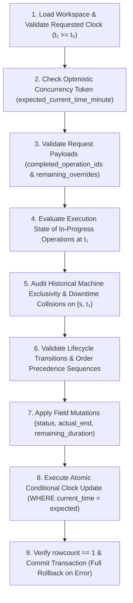
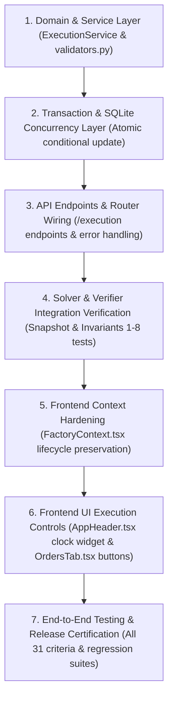

# OPWISE — MILESTONE 15D: SHOP-FLOOR EXECUTION CONTROLS
## Final Hardened Domain Specification, Execution-Time Semantics & Implementation-Ready Plan

**Document Type:** Final Hardened Domain Specification, Execution-Time Semantics & Implementation-Ready Plan
**Project:** Opwise — Intelligent Operations. Optimized Decisions.
**Repository:** `TERMINATOR7732/Opwise`
**Working Directory:** `E:\MHT CET REGISTRATION\BE\Task\Opwise`
**Target Milestone:** Milestone 15D — Shop-Floor Execution Controls
**Author:** Software Verification Specialist, OR Engineer, System Architect
**Date:** 2026-10-20
**Implementation Authorization Status:** **NOT GRANTED / DESIGN-ONLY SPECIFICATION**
**Operating Budget:** Strict ₹0 (Local-first, zero paid APIs, zero external cloud dependencies)

---

## 1. Executive Decision Summary

Milestones 15A, 15A.1, 15B, and 15C successfully established execution-aware foundations in Opwise:
- **Milestone 15A / 15A.1:** Introduced execution-aware domain entities, lifecycle states (`PLANNED`, `IN_PROGRESS`, `COMPLETED`), and relational database schema persistence for the factory plant clock (`workspaces.current_time_minute`) and operation lifecycle fields.
- **Milestone 15B:** Incorporated the plant clock and operation lifecycle locking into the Google OR-Tools CP-SAT scheduler, independent schedule verification across all 8 core invariants, and 4-bar lifecycle rendering in the Gantt canvas.
- **Milestone 15C:** Extended execution-state preservation into disruption recovery, downtime collision validation, rush order sequencing, and dual-Gantt comparative visualization.

Despite these capabilities, **Opwise currently provides zero user-facing controls to advance the plant clock or execute operation state transitions through the UI**.
- The plant clock can currently only be modified by sending a raw `PUT /api/v1/workspaces/{id}/factory` payload containing a full replacement of all machines, downtimes, and orders.
- In `FactoryRepository.replace_factory`, full replacement executes bulk `DELETE` on all order and machine rows and regenerates new UUIDs for every operation, completely destroying client references, active Gantt selections, and historical tracking.
- The frontend Factory UI (`FactoryContext.tsx`, `OrdersTab.tsx`, `OrderModal.tsx`) completely omits the plant clock and strips operation lifecycle states (`status`, `actual_start_minute`, `actual_end_minute`, `remaining_duration_minutes`) when updating or saving orders and machines.
- Users inspecting an active schedule in `SchedulesView.tsx` or `GanttOperationDetail.tsx` see read-only lifecycle badges, but have no interactive mechanism to mark a scheduled operation as started or completed.

### Final Contract Decisions:
1. **Candidate 1 (Intent-Driven Execution Service with Header Clock Control and Contextual Operation Actions) is formally confirmed** with weighted scoring of **4.90 / 5.00** against realistic alternatives.
2. **Completion Timestamp Contract Resolved (Smaller, Safer Scope Chosen):**
   - **Default Completion Time:** In bundled clock advancement (`POST /clock/advance`), any operation confirmed complete without an earlier timestamp is recorded strictly at the destination clock ($actual\_end\_minute = destination\_time$). Standalone completion (`POST /operations/{id}/complete`) records strictly at the current plant clock ($actual\_end\_minute = current\_time\_minute$).
   - **No Fictitious Inferences:** Projected completion ($C_{proj} = t_0 + r_0$) is strictly a mathematical estimate, **never an observed physical fact**. The system will **never** automatically mark an operation complete merely because the clock reaches or crosses $C_{proj}$.
   - **Scope Decision on Historical Completion:** Evaluated whether an arbitrary supervisor-supplied earlier completion timestamp (`actual_end_minute < destination_time`) is essential for Milestone 15D. **Decision: Deferred to maintain a smaller, safer, and cleaner scope.** In a discrete shop-floor simulation, recording an earlier completion time is naturally and safely achieved by advancing the clock to that specific minute, confirming completion, and then advancing the clock further. This eliminates unverified human declarations, arbitrary backdating anomalies, and UI timestamp input complexity.
3. **Overdue Execution Policy B (Explicit Remaining-Work Reconciliation) Enforced:**
   - The 1-minute clamp (Option A) and zero-lock approach (Option D) are permanently rejected.
   - When clock advancement reaches or passes estimated finish ($\Delta \ge r_0$), advancing without explicit instructions fails with HTTP 422 `OVERDUE_RECONCILIATION_REQUIRED`.
   - The user must either confirm completion (`completed_operation_ids: list[str]`) or provide a supervisor remaining-work override ($r_1 \ge 1$).
4. **SQLite Concurrency Strategy (Atomic Conditional Test-and-Set):**
   - Code inspection reveals the application uses SQLite with `aiosqlite` and SQLAlchemy 2.0.36. SQLite operates with database-level locking and ignores row-level locks (`SELECT ... FOR UPDATE`).
   - Standard `BEGIN DEFERRED` transactions can allow two concurrent requests to read the same clock and silently overwrite each other.
   - To guarantee concurrency safety without schema changes, the execution service enforces an **atomic conditional SQL `UPDATE`** (`WHERE id = :workspace_id AND current_time_minute = :expected_clock`).
   - If a competing request has already modified the clock, the statement updates 0 rows (`rowcount == 0`), immediately raising `LifecycleStateError` with error code `STALE_EXECUTION_STATE` (HTTP 409) and triggering an automatic transaction rollback.
5. **Zero Database Migrations Required:** Inspected SQLite schema (Alembic migration 003) contains 100% of the columns, check constraints, foreign keys, and indices required to support all proposed execution states.
6. **Strict Non-Implementation Guarantee:** This run modifies **solely** this specification document. No production code, tests, migrations, fixtures, or lockfiles have been modified, and zero git commits or pushes have occurred.

---

## 2. Verified Repository Baseline

A comprehensive read-only Git preflight was executed to establish the exact repository baseline:

| Dimension | Audit Finding | Standard | Evidence / Command |
|---|---|---|---|
| **Repository Root** | `E:\MHT CET REGISTRATION\BE\Task\Opwise` | **Verified** | `git rev-parse --show-toplevel` |
| **Current Branch** | `main` | **Verified** | `git branch --show-current` |
| **Current HEAD SHA** | `e6bd8ee8a895838118a1d24593cc4e7cab77b256` | **Verified** | `git rev-parse HEAD` |
| **Parent Commit SHA** | `954b6a72206f70cb81528226d8bbc3694b402f4d` | **Verified** | `git log -n 1 --format="%P"` |
| **Upstream Sync** | `origin/main` (synchronized, +0/-0) | **Verified** | `git status -sb` |
| **Working Tree Status** | Clean working tree except for 2 designated untracked reports: `MILESTONE_15C_POST_IMPLEMENTATION_AUDIT_REPORT.md` and `MILESTONE_15D_SCOPE_PROPOSAL.md` | **Verified** | `git status --short` |
| **Whitespace Quality** | Clean, zero trailing whitespace or carriage return anomalies | **Verified** | `git diff --check` (exit code 0) |
| **Milestone 15C Commit** | `e6bd8ee` feat(scenarios): execution-aware disruption recovery and dual Gantt lifecycle integration | **Verified** | `git log -n 1 e6bd8ee` |
| **Milestone 15C Implementation Report** | Committed at repo root: `MILESTONE_15C_IMPLEMENTATION_REPORT.md` (9,631 bytes) | **Verified** | `git log` file inspection |
| **Milestone 15C Audit Report** | Present on disk: `MILESTONE_15C_POST_IMPLEMENTATION_AUDIT_REPORT.md` (18,004 bytes) | **Verified** | File inspection on disk |
| **Demo Fixtures** | Bitwise identical to baseline across all 6 fixtures (`demo1_normal.json` .. `demo6_invalid.json`) | **Verified** | `git diff --exit-code 954b6a7 e6bd8ee -- frontend/src/demo/fixtures` (exit code 0) |
| **Sibling Projects** | `Integris`, `CodeShip`, `PathForge` untouched in parent directory | **Verified** | Directory inspection |

---

## 3. Explicit Actual-Versus-Estimated Time Semantics

A critical vulnerability identified during design auditing was the potential conflation of estimated completion with physical observed completion. In Milestone 15D, these concepts are mathematically separated and strictly enforced:

### 3.1 Separate Concept Definitions
1. **Simulated Factory Clock (`current_time_minute`, $t$):**
   - The master discrete timestamp representing "now" on the shop floor.
   - Non-negative integer ($t \in \mathbb{N}_0$).
   - Can advance monotonically forward via intentional execution actions.
2. **Actual Execution Start (`actual_start_minute`, $s_{actual}$):**
   - The recorded minute at which an operation physically began execution on its assigned machine.
   - Fixed historical timestamp; once recorded, it satisfies $s_{actual} \le t$ and remains immutable while in progress.
3. **Estimated Remaining Duration (`remaining_duration_minutes`, $r$):**
   - The current human or parametric estimate of processing minutes required to finish the job from the current plant clock $t$.
   - Positive integer ($r \ge 1$) while status is `IN_PROGRESS`.
   - Strictly `None` when status is `PLANNED` or `COMPLETED`.
4. **Projected Completion ($C_{proj}$):**
   - Derived estimate: $C_{proj} = t + r$.
   - **Crucial Rule:** $C_{proj}$ is a mathematical projection, **never an observed physical fact**. Advancing the clock past $C_{proj}$ is not evidence that the work completed.
5. **Actual Execution End (`actual_end_minute`, $e_{actual}$):**
   - An observed, confirmed timestamp indicating when work physically concluded on the machine.
   - Recorded strictly when an operation transitions to `COMPLETED`.
   - Must strictly satisfy $s_{actual} < e_{actual} \le t$ (strictly positive execution duration; cannot complete in the future).

### 3.2 Evaluation of Completion Time Policies: Default vs. Historical Backdating

We evaluated two alternative policies for recording completion during clock advancement:

#### Alternative 1: Explicit Historical Completion Backdating (`actual_end_minute < destination_time`)
- In this design, the client supplies an optional historical completion timestamp earlier than the destination clock.
- **Analysis:**
  - The application cannot independently verify whether a supervisor-reported historical timestamp is factually true.
  - Treating the interval between the backdated completion and destination clock as "idle" requires complex retrospective machine exclusivity and downtime audits.
  - Requires complex UI input fields for operators to type historical minute values into modals.
  - Introduces risk of accidental retrospective collisions.

#### Alternative 2: Default Destination Completion Time (Recommended & Formally Adopted)
- In bundled clock advancement (`POST /clock/advance`), any operation listed in `completed_operation_ids` has its completion recorded at the destination clock:
  $$actual\_end\_minute = destination\_time$$
- In standalone completion (`POST /operations/{id}/complete`), completion is recorded at the current plant clock:
  $$actual\_end\_minute = current\_time\_minute$$
- **How Discrete Simulation Handles Intermediate Completions:**
  - In a discrete simulation environment, if an operator knows an operation finished at minute 108 and the current clock is 100, the supervisor simply advances the clock in discrete steps:
    1. Advance clock to 108 with bundled completion of the operation (recorded cleanly at 108).
    2. Advance clock from 108 to 120 (machine is cleanly idle on $[108, 120)$).
  - This completely solves the downtime boundary case without requiring any unverified historical backdating.
- **Verdict: Adopted as the smaller, safer, and cleaner scope for Milestone 15D.**

### 3.3 Clock Advance Request Contract
A clock advance request from $t_0$ to destination clock $t_1$ ($\Delta = t_1 - t_0 \ge 0$) handles active in-progress operations under one of three explicit branches:

#### Branch A: Clock Advance Without Completion Confirmation
- Permitted only when every in-progress operation has remaining duration strictly greater than the clock jump:
  $$\Delta < r_0 \quad \forall \text{ active ops}$$
- Each active operation automatically decrements remaining duration:
  $$r_1 = r_0 - \Delta$$
- The projected completion remains invariant:
  $$C_{proj}(t_1) = t_1 + r_1 = (t_0 + \Delta) + (r_0 - \Delta) = t_0 + r_0 = C_{proj}(t_0)$$
- **Boundary / Overdue Gate:** If any active operation has $\Delta \ge r_0$, the bare clock advance is **strictly rejected with HTTP 422 `OVERDUE_RECONCILIATION_REQUIRED`**. The system **never** infers completion, never fabricates a 1-minute lock, and never sets $r=0$.

#### Branch B: Clock Advance With Explicit Bundled Completion
- The request includes `completed_operation_ids: list[str]`.
- For each specified operation:
  - Validates operation is currently `IN_PROGRESS` and $t_1 > s_{actual}$.
  - Records:
    $$actual\_end\_minute = t_1$$
    $$status = \text{COMPLETED}$$
    $$remaining\_duration\_minutes = \text{None}$$
  - Machine is occupied on $[s_{actual}, t_1)$ and freed at $t_1$.
  - Audits $[s_{actual}, t_1)$ against all machine downtimes. Any overlap rejects the entire transaction with HTTP 422 `HISTORICAL_DOWNTIME_CONFLICT`.

#### Branch C: Clock Advance With Remaining-Duration Overrides
- The request includes `remaining_duration_overrides: dict[str, int]`:
  ```json
  {
    "op-uuid-2": 15
  }
  ```
- Represents the supervisor's physical estimate of remaining work **at destination time $t_1$**.
- Must be a strictly positive integer ($r_1 \ge 1$).
- Projected completion moves to:
  $$C_{proj, new} = t_1 + r_1$$
- Depending on the supervisor's input, $C_{proj, new}$ can be earlier or later than the original estimate.
- Evaluated and validated before persisting any change.

---

## 4. SQLite Concurrency Strategy and Atomic Transaction Contract

### 4.1 Inspected Database Architecture & Concurrency Realities
Direct inspection of `backend/opwise/persistence/database.py`, `backend/opwise/config.py`, and runtime dependencies reveals:
1. **Engine:** `sqlite+aiosqlite:///./opwise.sqlite3` with SQLite 3.42.0 and SQLAlchemy 2.0.36.
2. **Pragmas Configured:** `PRAGMA foreign_keys = ON;`, `PRAGMA busy_timeout = 5000;`, `PRAGMA synchronous = NORMAL;`, `PRAGMA journal_mode = WAL;`.
3. **SQLite Locking Mechanics:**
   - SQLite uses **database-level locking**, NOT row-level locking.
   - Calling `select(WorkspaceModel).with_for_update()` has **zero effect** on SQLite; the SQLAlchemy SQLite dialect compiler silently ignores `FOR UPDATE`.
   - In SQLite WAL mode, transactions begin by default as `DEFERRED`. They acquire a shared read lock and do not acquire a write lock until the first mutating statement (`UPDATE`, `INSERT`, `DELETE`).
4. **The Concurrency Hazard:**
   - If two concurrent requests query the database at clock 100, both read `current_time_minute == 100`.
   - If both requests check `expected_current_time_minute == 100` in Python, both checks pass!
   - Request 1 updates the clock to 115 and commits.
   - Request 2 (after waiting for Request 1's lock) executes and updates the clock to 110 and commits.
   - Request 2 silently overwrites Request 1's work, moving the plant clock backward!

### 4.2 The SQLite Concurrency Solution: Atomic Conditional Test-and-Set
To guarantee race-free concurrency on SQLite without schema migrations:
1. **Conditional SQL Update:**
   Clock advancement and execution transitions perform an atomic conditional update at the SQL level:
   ```python
   stmt = (
       update(WorkspaceModel)
       .where(WorkspaceModel.id == workspace_id)
       .where(WorkspaceModel.current_time_minute == expected_current_time_minute)
       .values(current_time_minute=destination_time_minute)
   )
   result = await session.execute(stmt)
   if result.rowcount == 0:
       # Rowcount 0 proves either workspace does not exist or clock has already changed concurrently!
       ws = await session.get(WorkspaceModel, workspace_id)
       if ws is None:
           raise ResourceNotFoundError("Workspace", workspace_id)
       raise LifecycleStateError(
           f"Stale execution state: expected clock {expected_current_time_minute}, but current clock is {ws.current_time_minute}",
           error_code="STALE_EXECUTION_STATE",
       )
   ```
2. **Why This Is 100% Guaranteed on SQLite:**
   - SQLite serializes write statements.
   - When Request 1 executes the `UPDATE`, it acquires the exclusive write lock, finds `current_time_minute == 100`, updates 1 row, and commits.
   - When Request 2 executes the `UPDATE`, `current_time_minute` in the database is now 115. The `WHERE current_time_minute == 100` clause matches 0 rows!
   - `result.rowcount` is 0. Request 2 immediately raises `STALE_EXECUTION_STATE` (HTTP 409), triggers a session rollback, and aborts with zero mutations.
3. **Implicit Optimistic Token When Omitted:**
   - If the client omits `expected_current_time_minute`, the service uses the initial read clock $t_0$ as the implicit expected token in the conditional update. This prevents concurrent requests from interleaving or overwriting even when the client does not provide an explicit token.
4. **Busy Timeout & Lock Failure Mapping:**
   - If SQLite raises `sqlite3.OperationalError: database is locked` (after the 5000ms busy timeout), it is mapped by FastAPI error handlers to HTTP 409 `CONCURRENT_EXECUTION_CONFLICT` rather than an unhandled 500 error.

### 4.3 Nine-Step Atomic Transaction Sequence
All execution logic executes inside `ExecutionService` within a single SQLAlchemy asynchronous transaction: `async with session.begin():`:



1. **Step 1: Load Workspace & Validate Clock Bounds:**
   - Load `WorkspaceModel` row. Verify $t_1 \ge 0$ and $t_1 \ge t_0$. If $t_1 < t_0$, raise `INVALID_CLOCK` (HTTP 422).
2. **Step 2: Check Optimistic Concurrency Token:**
   - If `expected_current_time_minute` is provided and $\ne ws.current_time_minute$, raise `STALE_EXECUTION_STATE` (HTTP 409).
3. **Step 3: Validate Request Payloads:**
   - Verify all IDs in `completed_operation_ids` and `remaining_duration_overrides` exist and currently have status `IN_PROGRESS`.
   - If an operation appears in both payloads, reject with `INVALID_LIFECYCLE_STATE` (HTTP 422).
4. **Step 4: Evaluate In-Progress Operations at Destination Time $t_1$:**
   - For each active operation:
     - If in `completed_operation_ids`: validate $t_1 > s_{actual}$.
     - If in `remaining_duration_overrides`: validate $r_1 \ge 1$.
     - If neither: check $\Delta < r_0$. If $\Delta \ge r_0$, raise `OVERDUE_RECONCILIATION_REQUIRED` (HTTP 422).
5. **Step 5: Audit Historical Machine Exclusivity & Downtime Collisions:**
   - For completed operations: verify interval $[s_{actual}, t_1)$ does not intersect any machine downtime $[D_s, D_e)$ on that machine:
     $$\max(s_{actual}, D_s) < \min(t_1, D_e)$$
   - For continuing in-progress operations: verify elapsed execution $[s_{actual}, t_1)$ does not intersect any machine downtime.
   - Verify zero historical machine occupancy overlap between any two operations.
6. **Step 6: Validate Lifecycle Transitions & Order Precedence:**
   - Ensure order sequence rules are maintained.
7. **Step 7: Apply Field Mutations:**
   - Completed operations: `status = COMPLETED`, `actual_end_minute = t_1`, `remaining_duration_minutes = None`.
   - Overridden operations: `remaining_duration_minutes = r_1`.
   - Automatically decremented operations: `remaining_duration_minutes = r_0 - \Delta`.
8. **Step 8: Execute Atomic Conditional Clock Update:**
   - Execute conditional update on `workspaces` table matching expected/baseline clock.
9. **Step 9: Verify Rowcount & Commit:**
   - Assert `result.rowcount == 1`. If 0, raise `STALE_EXECUTION_STATE` (HTTP 409).
   - Session commits all changes atomically.

### 4.4 Rollback Guarantees
If any step raises an exception:
- The transaction rolls back completely.
- **Zero rows mutated:** Clock does not advance; remaining durations are not reduced; no operations are completed.
- HTTP error response is returned with stable code and detailed context.

---

## 5. Remaining-Duration Mathematics and Concrete Scenarios

### 5.1 Mathematical Formulation
Let:
- $t_0 \in \mathbb{N}_0$ be the plant clock before advancement.
- $t_1 \in \mathbb{N}_0$ be the requested destination clock ($t_1 \ge t_0$).
- $\Delta = t_1 - t_0$ be elapsed minutes.
- $s_{actual} \in \mathbb{N}_0$ be the actual start minute ($s_{actual} \le t_0$).
- $r_0 \in \mathbb{N}^+$ be the remaining duration at $t_0$.
- $C_{proj, 0} = t_0 + r_0$ be the projected completion time at $t_0$.

#### Case 1: Partial Progress ($0 < \Delta < r_0$)
$$r_1 = r_0 - \Delta$$
$$C_{proj, 1} = t_1 + r_1 = (t_0 + \Delta) + (r_0 - \Delta) = t_0 + r_0 = C_{proj, 0}$$
The projected finish is mathematically invariant under ordinary clock advances.

#### Case 2: Boundary or Overdue ($\Delta \ge r_0$)
Automatic decrement is impossible because $r_0 - \Delta \le 0$, which violates database check constraint `chk_op_remaining_duration_positive` ($r \ge 1$).
The operation **must be explicitly reconciled**:
- **Option 1 (Completion):** Operation listed in `completed_operation_ids`. Recorded with $actual\_end\_minute = t_1$, status `COMPLETED`, $r_1 = None$.
- **Option 2 (Override):** Supervisor provides $r_1 \in \mathbb{N}^+$. New projected finish becomes:
  $$C_{proj, new} = t_1 + r_1$$

#### Case 3: Equal-Clock Request ($t_1 == t_0$)
- If no completions or overrides attached: Idempotent no-op returning HTTP 200 with current state. Zero database writes.
- If completions or overrides attached: Reconciles operations at current clock $t_0$ (e.g. marking operation completed at $t_0$, provided $t_0 > s_{actual}$).

### 5.2 Eight Concrete Operational Scenarios

| Scenario # | Description | Parameters at $t_0$ | Destination $t_1$ / Action | Expected Result & Code | State Persisted? |
|:---:|---|---|---|---|:---:|
| **1** | **Partial Progress** | $t_0=100$, Op 1 $s=100, r=60$ ($C_{proj}=160$) | Advance $\Delta=15$ ($t_1=115$), no overrides | HTTP 200 OK. $t=115$, Op 1 $r=45$. Projected finish remains 160. | **Yes** (Clock 115, $r=45$) |
| **2** | **Advancing Exactly to Projected Finish (Bare)** | $t_0=100$, Op 1 $s=100, r=10$ ($C_{proj}=110$) | Advance $\Delta=10$ ($t_1=110$), no overrides | HTTP 422 `OVERDUE_RECONCILIATION_REQUIRED`. System refuses to clamp to 1 or auto-complete. | **No** (Rollback, clock 100) |
| **3** | **Advancing Beyond Projected Finish (Bare)** | $t_0=100$, Op 1 $s=100, r=10$ ($C_{proj}=110$) | Advance $\Delta=15$ ($t_1=115$), no overrides | HTTP 422 `OVERDUE_RECONCILIATION_REQUIRED`. System refuses to invent duration. | **No** (Rollback, clock 100) |
| **4** | **Override at Destination Time** | $t_0=100$, Op 1 $s=100, r=10$ ($C_{proj}=110$) | Advance $t_1=115$, override `{"op-1": 15}` | HTTP 200 OK. $t=115$, Op 1 $r=15$. $C_{proj, new} = 115 + 15 = 130$. | **Yes** (Clock 115, $r=15$) |
| **5** | **Bundled Completion at Destination Clock** | $t_0=100$, Op 1 $s=100, r=10$ ($C_{proj}=110$) | Advance $t_1=110$, completed `["op-1"]` | HTTP 200 OK. $t=110$, Op 1 `COMPLETED` at 110. Machine freed at 110. | **Yes** (Clock 110, Op 1 done at 110) |
| **6** | **Repeated Clock Advances** | $t_0=100$, Op 1 $s=100, r=20$ | Step 1: advance $t_1=110$.<br>Step 2: advance $t_2=115$. | Step 1: HTTP 200, $t=110, r=10, C=120$.<br>Step 2: HTTP 200, $t=115, r=5, C=120$. | **Yes** (Clock 115, $r=5$, finish 120) |
| **7** | **Two In-Progress Ops Reconciled Together** | $t_0=100$, Op 1 $r=10$ on M1, Op 2 $r=15$ on M2 | Advance $t_1=115$, Op 1 in `completed_operation_ids`, Op 2 in `completed_operation_ids` | HTTP 200 OK. Both reconciled complete at 115. Both machines freed. | **Yes** (Both ops completed cleanly) |
| **8** | **One Valid & One Invalid Reconciliation in Same Call** | $t_0=100$, Op 1 $r=10$ on M1, Op 2 $r=15$ on M2 | Advance $t_1=115$, Op 1 in `completed_operation_ids`, Op 2 omitted | HTTP 422 `OVERDUE_RECONCILIATION_REQUIRED` for Op 2. Total rollback. | **No** (Clock remains 100, Op 1 remains in progress) |

---

## 6. Downtime and Historical Execution Semantics

All temporal intervals in Opwise are strictly **half-open: $[start, end)$**.

### 6.1 Core Downtime Invariants
1. **Half-Open Boundary Contact:**
   - An interval ending at minute $T$ and an interval starting at minute $T$ do not intersect:
     $$[s, T) \cap [T, e) = \emptyset$$
   - An operation finishing exactly when downtime begins does not overlap downtime.
   - Downtime ending exactly when an operation starts does not overlap the operation.
2. **Strict Non-Preemption:**
   - Opwise does not model pause-and-resume execution across maintenance windows. An operation cannot run during machine downtime under any circumstance.
3. **Completed History Is Fixed:**
   - Once an operation completes with interval $[s_{actual}, e_{actual})$, that interval is fixed.
4. **Distinct In-Progress Intervals:**
   - An in-progress operation has two distinct intervals:
     - **Past / Elapsed Execution:** $[s_{actual}, t_0)$ (or $[s_{actual}, t_1)$ upon advance). Must have zero intersection with machine downtime.
     - **Future Scheduler Lock:** $[t_0, t_0 + r)$ (or $[t_1, t_1 + r_1)$). Treated as a fixed unavailable interval by the CP-SAT scheduler.

### 6.2 Rigorous Analysis of Seven Specific Downtime Cases

```mermaid
flowchart TD
    subgraph Case1["Case 1: Boundary Contact (Valid)"]
        OP1["Op: [100, 110)"] --- DT1["Downtime: [110, 140)"]
    end
    subgraph Case2["Case 2: Discrete Advance Preceding Downtime (Valid)"]
        OP2["Op Complete: [100, 110)"] --- IDLE2["Idle: [110, 115)"] --- DT2["Downtime: [115, 145)"]
    end
    subgraph Case3["Case 3: Historical Overlap (Rejected)"]
        OP3["Op Execution: [100, 120)"]
        DT3["Downtime: [110, 130)"]
        OP3 -.->|COLLISION [110, 120)| DT3
    end
```

1. **Case 1: Operation $[100, 110)$, Downtime $[110, 140)$:**
   - Boundary contact at minute 110:
     $$[100, 110) \cap [110, 140) = \emptyset$$
   - **Verdict:** Valid. Zero collision. Invariant INV-6 verified.
2. **Case 2: Operation Finished at 110, Downtime $[115, 145)$, Advance to 120:**
   - Handled via discrete advancement: Supervisor advances clock to 110 with bundled completion. Actual interval is $[100, 110)$.
   - Supervisor then advances clock to 120. Interval $[110, 120)$ is machine IDLE.
   - Downtime on machine $[115, 145)$ is active at clock 120, but does not intersect the completed operation $[100, 110)$.
   - **Verdict:** Valid. Zero collision.
3. **Case 3: Operation's Execution Overlaps Downtime Beginning Before Completion:**
   - Operation started at 100, completed at 120 ($[100, 120)$). Downtime on machine at $[110, 130)$.
   - Intersection: $[100, 120) \cap [110, 130) = [110, 120) \ne \emptyset$.
   - **Verdict:** Rejected with HTTP 422 `HISTORICAL_DOWNTIME_CONFLICT`. Transaction rolls back.
4. **Case 4: Remaining-Duration Override Projects Operation into Future Downtime:**
   - Clock advanced to 100. Supervisor provides override $r=30$ ($C_{proj}=130$, lock $[100, 130)$). Scheduled downtime exists on machine at $[120, 150)$.
   - **Verdict:** Execution transaction persists state (domain allows human supervisor to declare work remaining). However, subsequent `POST /optimize` returns CP-SAT `INFEASIBLE` because the fixed lock $[100, 130)$ overlaps fixed downtime $[120, 150)$. UI alerts supervisor that machine maintenance must be rescheduled.
5. **Case 5: Completion at Destination Clock Overlaps Active Downtime:**
   - Clock advances to 130 with bundled completion for operation started at 100. Downtime exists on machine at $[120, 140)$.
   - Historical interval $[100, 130)$ intersects downtime $[120, 130) \ne \emptyset$.
   - **Verdict:** Rejected with HTTP 422 `HISTORICAL_DOWNTIME_CONFLICT`. Transaction rolls back.
6. **Case 6: Two Operations Touch at Boundary:**
   - Op 1 completed $[100, 110)$. Op 2 starts at 110 with duration 15 ($[110, 125)$).
   - Intersection: $[100, 110) \cap [110, 125) = \emptyset$.
   - **Verdict:** Valid. Machine exclusivity verified (Invariant INV-5).
7. **Case 7: Completion Timestamp Conflicts with Another Operation on Same Machine:**
   - Op A started at 100, completed at 115 ($[100, 115)$). Op B had already started on that machine at minute 110.
   - Intersection: $[100, 115) \cap [110, \dots) = [110, 115) \ne \emptyset$.
   - **Verdict:** Rejected with HTTP 422 `MACHINE_OCCUPIED`. Transaction rolls back.

---

## 7. Proposed API Contract

The execution service exposes 5 distinct endpoints under `/api/v1/workspaces/{workspace_id}/execution`:

### 7.1 Endpoint Catalog & Responsibilities

| Endpoint | HTTP Method & Path | Primary Responsibility | Can Mutate Clock? |
|---|---|---|:---:|
| **1. Advance Clock** | `POST /clock/advance` | Advance plant clock, decrement remaining durations, reconcile completed or delayed ops | **Yes (Only endpoint)** |
| **2. Start Operation** | `POST /operations/{id}/start` | Transition `PLANNED` $\to$ `IN_PROGRESS` at current clock $t_0$ | No |
| **3. Complete Operation** | `POST /operations/{id}/complete` | Transition `IN_PROGRESS` $\to$ `COMPLETED` at current clock $t_0$ | No |
| **4. Adjust Remaining** | `PATCH /operations/{id}/remaining` | Supervisor adjustment of $r \ge 1$ without clock advance | No |
| **5. Execution Status** | `GET /status` | Read-only view of active jobs, ready-to-start jobs, and occupied machines | No |

### 7.2 Detailed Endpoint Specifications

#### 1. Advance Plant Clock
- **Path:** `POST /api/v1/workspaces/{workspace_id}/execution/clock/advance`
- **Request Schema:** `ClockAdvanceRequest`
  ```json
  {
    "advance_by_minutes": 15,
    "target_time_minute": null,
    "expected_current_time_minute": 100,
    "completed_operation_ids": [
      "op-uuid-1"
    ],
    "remaining_duration_overrides": {
      "op-uuid-2": 25
    }
  }
  ```
- **Response Schema:** `SuccessEnvelope[ExecutionStatusResponse]`
- **Preconditions:**
  - Exactly one of `advance_by_minutes` ($\ge 0$) or `target_time_minute` ($\ge t_0$) must be provided.
  - If `expected_current_time_minute` is provided, must equal `ws.current_time_minute`.
  - All operations with $\Delta \ge r_0$ must appear in `completed_operation_ids` or `remaining_duration_overrides`.
  - No elapsed execution interval intersects machine downtime.
- **Error Codes:**
  - `INVALID_CLOCK` (422): Negative clock or backward clock movement requested.
  - `OVERDUE_RECONCILIATION_REQUIRED` (422): Operation reached projected finish without reconciliation instructions.
  - `HISTORICAL_DOWNTIME_CONFLICT` (422): Operation elapsed interval intersects machine downtime.
  - `STALE_EXECUTION_STATE` (409): `expected_current_time_minute` does not match database or concurrent conditional update matched 0 rows.

#### 2. Start Operation
- **Path:** `POST /api/v1/workspaces/{workspace_id}/execution/operations/{operation_id}/start`
- **Request Schema:** `StartOperationRequest`
  ```json
  {
    "estimated_remaining_duration_minutes": null,
    "expected_current_time_minute": 100
  }
  ```
- **Response Schema:** `SuccessEnvelope[ExecutionStatusResponse]`
- **Preconditions:**
  - Target operation status is strictly `PLANNED`.
  - Order release time: $order.release\_time\_minutes \le t_0$.
  - Predecessor sequence: Predecessor operation $k-1$ in the order has status `COMPLETED` and $actual\_end\_minute \le t_0$.
  - Order concurrency: Order has 0 other operations with status `IN_PROGRESS`.
  - Machine exclusivity: Assigned machine has 0 operations with status `IN_PROGRESS`.
  - Machine downtime: Machine is not in downtime at $t_0$ ($D_s \le t_0 < D_e$).
- **Mutations (Atomic):**
  - `status = IN_PROGRESS`
  - `actual_start_minute = t_0`
  - `actual_end_minute = None`
  - `remaining_duration_minutes = estimated_remaining_duration_minutes or op.processing_minutes`
- **Error Codes:** `INVALID_LIFECYCLE_STATE` (422), `INVALID_SEQUENCE` (422), `MACHINE_OCCUPIED` (422), `HISTORICAL_DOWNTIME_CONFLICT` (422), `STALE_EXECUTION_STATE` (409).

#### 3. Complete Operation
- **Path:** `POST /api/v1/workspaces/{workspace_id}/execution/operations/{operation_id}/complete`
- **Request Schema:** `CompleteOperationRequest`
  ```json
  {
    "expected_current_time_minute": 100
  }
  ```
- **Response Schema:** `SuccessEnvelope[ExecutionStatusResponse]`
- **Preconditions:**
  - Target operation status is strictly `IN_PROGRESS`.
  - Strictly positive duration: $t_0 > actual\_start\_minute$. Cannot complete at start minute ($t_0 == s_{actual}$).
  - No downtime collision in $[actual\_start\_minute, t_0)$.
- **Mutations (Atomic):**
  - `status = COMPLETED`
  - `actual_start_minute` preserved unchanged
  - `actual_end_minute = t_0`
  - `remaining_duration_minutes = None`
- **Error Codes:** `INVALID_LIFECYCLE_STATE` (422), `HISTORICAL_DOWNTIME_CONFLICT` (422), `STALE_EXECUTION_STATE` (409).

#### 4. Adjust Remaining Duration
- **Path:** `PATCH /api/v1/workspaces/{workspace_id}/execution/operations/{operation_id}/remaining`
- **Request Schema:** `AdjustRemainingRequest`
  ```json
  {
    "remaining_duration_minutes": 20,
    "expected_current_time_minute": 100
  }
  ```
- **Response Schema:** `SuccessEnvelope[ExecutionStatusResponse]`
- **Preconditions:**
  - Operation status is strictly `IN_PROGRESS`.
  - `remaining_duration_minutes` $\ge 1$.
- **Error Codes:** `INVALID_LIFECYCLE_STATE` (422), `INVALID_DURATION` (422), `STALE_EXECUTION_STATE` (409).

#### 5. Get Execution Status Overview
- **Path:** `GET /api/v1/workspaces/{workspace_id}/execution/status`
- **Response Schema:** `SuccessEnvelope[ExecutionStatusResponse]`

### 7.3 Client Refresh Contract
When a client encounters HTTP 409 `STALE_EXECUTION_STATE` or HTTP 422 `OVERDUE_RECONCILIATION_REQUIRED`:
1. Client fetches fresh status via `GET /status`.
2. UI synchronizes local clock display to `current_time_minute`.
3. If reconciliation is required, UI surfaces the Reconciliation Modal with the fresh remaining durations and projected completion times.

---

## 8. Solver, Verifier, and Scenario Recovery Invariants

A complete trace across the backend optimization and verification pipeline confirms full compatibility:

1. **Snapshot Immutability Invariant:**
   - Previously saved schedule records in `schedules` and `scheduled_operations` tables are **strictly immutable**.
   - Execution actions mutate only live rows in `workspaces` and `operations`.
   - Inspection of `OptimizationService.optimize_schedule` confirms that schedules are stored with their static `factory_snapshot`. Historical schedules remain 100% reproducible.
2. **Solver CP-SAT Lifecycle Integration:**
   - Tracing `backend/opwise/solver/constraints.py`:
     - Completed operations: Created as fixed intervals with start and end pinned to $[actual\_start, actual\_end)$.
     - In-progress operations: Created as fixed locked intervals with start pinned to $t_0$ and size pinned to $remaining\_duration$.
     - Planned operations: Created as standard decision variables with domain $[ \max(order.release, t_0), H ]$.
     - Precedence constraints: Enforces $start_{next} \ge end_{prev}$. In-progress ops gate successors at $t_0 + r$.
     - Machine exclusivity: OR-Tools `AddNoOverlap` naturally handles fixed completed intervals, locked in-progress intervals, future planned intervals, and clamped future downtimes on each machine.
3. **Independent Schedule Verifier Invariants:**
   - Tracing `backend/opwise/verifier/invariant_auditor.py`:
     - **INV-1 (Cardinality):** All operations present.
     - **INV-2 (Duration & Machine Assignment):** In-progress ops verified against $[t_0, t_0 + r)$; completed against $[actual\_start, actual\_end)$.
     - **INV-3 (Release Times & Plant Clock):** Planned operation start times verified $\ge \max(release, t_0)$.
     - **INV-4 (Precedence):** Strict sequence $start_{k} \ge end_{k-1}$ verified across all lifecycle combinations.
     - **INV-5 (Machine Exclusivity):** Zero overlap across all intervals on each machine.
     - **INV-6 (Downtime Respect):** Zero intersection with merged machine downtime windows.
     - **INV-7 (Horizon Bounds):** Non-negative timestamps $\le H$.
     - **INV-8 (Objective Metrics):** Makespan and total weighted tardiness independently recomputed with 0 float discrepancy.
4. **Scenario Disruption Recovery Invariants:**
   - Tracing `backend/opwise/services/scenario_math.py`:
     - Disruption synthesis validates new machine downtimes against current plant clock $t_0$.
     - Recovery scheduling re-solves from $t_0$ while preserving all completed work and active locks.
     - Dual Gantt visualization correctly renders live execution state against simulated scenario schedules.

---

## 9. Frontend Lifecycle and State Preservation Requirements

### 9.1 Discovered Hazards in Current Code
Direct inspection of `frontend/src/context/FactoryContext.tsx` verified two severe hazards:
1. **`buildOrdersPayload` strips lifecycle state:**
   ```typescript
   // CURRENT CODE in FactoryContext.tsx (lines 104-108):
   operations: (o.operations || []).map((op) => ({
     sequence_index: op.sequence_index,
     machine_id: op.machine_id,
     processing_minutes: op.processing_minutes,
   }))
   ```
   `status`, `actual_start_minute`, `actual_end_minute`, and `remaining_duration_minutes` are omitted.
2. **`saveConfig` omits `current_time_minute`:**
   In `useFactoryMutations`, payloads sent to `PUT /api/v1/workspaces/{id}/factory` do not pass `current_time_minute`.
3. **Catastrophic Clobbering Hazard:**
   If a user starts an operation or advances the clock, and subsequently edits an order description or machine name in the UI, clicking "Save" calls `PUT /factory`, which deletes all operations and regenerates them with status `PLANNED` and clock `0`!

### 9.2 Mandatory Frontend Hardening Specifications
1. **Harden `buildOrdersPayload`:**
   Update mapping to preserve all 4 lifecycle fields:
   ```typescript
   operations: (o.operations || []).map((op) => ({
     sequence_index: op.sequence_index,
     machine_id: op.machine_id,
     processing_minutes: op.processing_minutes,
     status: op.status,
     actual_start_minute: op.actual_start_minute,
     actual_end_minute: op.actual_end_minute,
     remaining_duration_minutes: op.remaining_duration_minutes,
   }))
   ```
2. **Preserve `current_time_minute` in Factory Payloads:**
   Update `useFactoryMutations` to include `current_time_minute: factory.current_time_minute` in all save payloads.
3. **Execution State Synchronization:**
   Add execution actions to `FactoryContext` or a dedicated `ExecutionService` client wrapper. When an execution endpoint succeeds, update `factory.current_time_minute` and corresponding operation models in local state immediately without triggering a full factory rewrite.

---

## 10. Reconciled Acceptance Register

The 31 acceptance criteria (`AC-15D-01` through `AC-15D-31`) are fully reconciled against the hardened domain semantics:

| ID | Category | Preconditions | Action / Input | Expected Domain State | Expected API Result | Expected Persisted State | Layer | Pass Condition |
|---|---|---|---|---|---|---|---|---|
| **AC-15D-01** | Clock Forward | Clock at $t_0 = 30$, no active ops | `POST /clock/advance` (+15m) | Clock is 45 | HTTP 200 `clock: 45` | `workspaces.current_time_minute == 45` | Integration | Clock updated |
| **AC-15D-02** | Clock Equal | Clock at $t_0 = 30$ | `POST /clock/advance` (+0m or target 30) | Clock remains 30 | HTTP 200 `clock: 30` (no-op) | `current_time_minute == 30` | Integration | Idempotent no-op |
| **AC-15D-03** | Clock Backward | Clock at $t_0 = 30$ | `POST /clock/advance` (target 20) | Clock remains 30 | HTTP 422 `INVALID_CLOCK` | `current_time_minute == 30` | Unit/API | Error code matches |
| **AC-15D-04** | Clock Negative | Clock at $t_0 = 0$ | `POST /clock/advance` (target -5) | Clock remains 0 | HTTP 422 `INVALID_CLOCK` | `current_time_minute == 0` | Unit/API | Error code matches |
| **AC-15D-05** | Clock Decrement Rem | Op running, $s=20, r=40$ at $t_0=20$ | Advance clock by 15 ($t_0 \to 35$) | $r = 40 - 15 = 25$ | HTTP 200 `rem: 25` | `op.remaining_duration_minutes == 25` | Domain/API | Invariant finish 60 |
| **AC-15D-06** | Clock Overdue Gate | Op running, $r=10$ at $t_0=20$ | Advance clock by 15 ($t_0 \to 35$) without reconciliation | Clock remains 20 | HTTP 422 `OVERDUE_RECONCILIATION_REQUIRED` | Unmutated (0 rows changed) | Domain/API | Blocked, no clamp to 1m |
| **AC-15D-07** | Clock Bundled Complete | Op running, $r=10$ at $t_0=20$ | Advance by 15 with `completed_operation_ids: ["op1"]` | Clock 35, Op `COMPLETED` | HTTP 200 with completed op | $actual\_end = 35$, $rem = None$ | Integration | Reconciled complete at destination clock |
| **AC-15D-08** | Discrete Multi-Hop Completion | Op running from 100 with projected finish 110. Downtime at $[115, 145)$. | Advance to 108 with bundled completion, then advance to 120 | Op done at 108. Machine IDLE $[108, 115)$, in DT at 120. | Both return HTTP 200 | Zero false downtime collisions | Integration | Discrete sequence verified |
| **AC-15D-09** | Projected Finish Never Inferred | Op running, $s=100, r=10$. Advance to 115 with override $r=15$. | `POST /clock/advance` to 115 | Op remains `IN_PROGRESS`, $actual\_end$ is `None` | HTTP 200 `rem: 15` | $actual\_end$ strictly NULL | Domain/API | Estimated finish never converted to end |
| **AC-15D-10** | Clock Bundled Override | Op running, $r=10$ at $t_0=20$ | Advance by 15 with override $r=10$ | Clock 35, Op `IN_PROGRESS` | HTTP 200 `rem: 10` | $rem = 10$, lock $[35, 45)$ | Integration | Reconciled delayed |
| **AC-15D-11** | Multi-Op Partial Fail Rollback | Op 1 ($r=10$), Op 2 ($r=10$) running at $t_0=20$ | Advance to 35: Op 1 in `completed_operation_ids`, Op 2 omitted | Clock remains 20, both ops unchanged | HTTP 422 `OVERDUE_RECONCILIATION_REQUIRED` | Unmutated (0 rows changed) | Integration | Full rollback verified |
| **AC-15D-12** | Consecutive Advances | Op running, $r=20$ at $t_0=0$ | Advance +10, then advance +5 | After 1st: $r=10$; After 2nd: $r=5$ | Both return HTTP 200 | Final clock 15, $r=5$ | Integration | Invariant preserved |
| **AC-15D-13** | Stale Clock Fencing & SQLite Concurrency | Client A expects clock 30; DB already at 45. | Advance with `expected_current_time_minute: 30` | Clock remains 45 | HTTP 409 `STALE_EXECUTION_STATE` | Conditional update matched 0 rows, rollback | API | Concurrency protected |
| **AC-15D-14** | Start Op Valid | Op is `PLANNED`, release $\le t_0$, machine free | `POST /operations/{id}/start` | Status `IN_PROGRESS`, $s=t_0, r=p$ | HTTP 200 `status: IN_PROGRESS` | Row updated with start & rem | Integration | Status verified |
| **AC-15D-15** | Start Before Release | Order release is 50, clock is 30 | `POST /operations/{id}/start` | Remains `PLANNED` | HTTP 422 `INVALID_SEQUENCE` | Unmutated | Unit/API | Error code matches |
| **AC-15D-16** | Start Unfinished Pred | Op 1 is `PLANNED`, attempt start Op 2 | `POST /operations/{op2}/start` | Remains `PLANNED` | HTTP 422 `INVALID_SEQUENCE` | Unmutated | Unit/API | Error code matches |
| **AC-15D-17** | Start Machine Busy | M1 already has Op A `IN_PROGRESS` | `POST /operations/{opB}/start` on M1 | Op B remains `PLANNED` | HTTP 422 `MACHINE_OCCUPIED` | Unmutated | Unit/API | Error code matches |
| **AC-15D-18** | Start During DT | M1 in downtime $[20, 60)$, clock is 30 | `POST /operations/{id}/start` on M1 | Remains `PLANNED` | HTTP 422 `HISTORICAL_DOWNTIME_CONFLICT` | Unmutated | Unit/API | Error code matches |
| **AC-15D-19** | Start Early/Late | Op scheduled for 50, clock is 40. Preconds met. | `POST /operations/{id}/start` | Status `IN_PROGRESS`, $s=40$ | HTTP 200 `start: 40` | Actual start 40 | Integration | Allowed |
| **AC-15D-20** | Duplicate Start | Op is already `IN_PROGRESS` | `POST /operations/{id}/start` | Remains `IN_PROGRESS` | HTTP 422 `INVALID_LIFECYCLE_STATE` | Unmutated | Unit/API | Error code matches |
| **AC-15D-21** | Complete Op Valid | Op `IN_PROGRESS` with $s=20$, clock is 45 | `POST /operations/{id}/complete` | Status `COMPLETED`, $e=45, r=\text{None}$ | HTTP 200 `status: COMPLETED` | Row updated with end & null rem | Integration | Machine freed |
| **AC-15D-22** | Complete at Start Min | Op started at 20, clock is 20 | `POST /operations/{id}/complete` | Remains `IN_PROGRESS` | HTTP 422 `INVALID_LIFECYCLE_STATE` | Unmutated | Unit/API | Error code matches |
| **AC-15D-23** | Complete Planned Op | Op is `PLANNED` | `POST /operations/{id}/complete` | Remains `PLANNED` | HTTP 422 `INVALID_LIFECYCLE_STATE` | Unmutated | Unit/API | Error code matches |
| **AC-15D-24** | Downtime Boundary Touch | Op completed $[100, 110)$, DT $[110, 140)$ | Advance clock to 110 | Valid, zero collision | HTTP 200 | Preserved | Solver/Verif | Invariant 6 passes |
| **AC-15D-25** | Schedule Snapshot Intact | S1 created at $t_0=0$ | Advance clock to 45, complete Op 1 | S1 snapshot untouched | S1 GET returns original snapshot | Schedule table unmutated | Integration | Immutable history |
| **AC-15D-26** | Reoptimize Post-Exec | Clock 45, Op 1 completed $[0, 30)$, Op 2 running $[30, 60)$ | Run `POST /optimize` | S2 locks Op 2, pins Op 1 | HTTP 200 `VERIFIED` | S2 saved with verification PASS | Integration | 8 invariants pass |
| **AC-15D-27** | Disruption Recovery | Clock 45, Op 1 running on M1. Inject rush order. | Run `POST /scenarios` recovery | Rush order scheduled $\ge 45$ | HTTP 200 `VERIFIED` | Scenario schedule valid | Integration | Preserves locks |
| **AC-15D-28** | UI Header Widget | Factory loaded with $t_0=25$ | Click `Advance +15m` in header | Header updates to 40m | Header displays 40m, Gantt line moves | Data refetched | Frontend Vitest | UI updates |
| **AC-15D-29** | Contextual Action Buttons | Order with mixed lifecycle | Inspect `OrdersTab` | Eligible planned ops show Start; running ops show Complete | Buttons rendered with correct state | Context preserved | Frontend Vitest | UI verified |
| **AC-15D-30** | Context Hardening | Op running in factory | Edit order due date in UI and save | Op remains `IN_PROGRESS`, clock preserved | PUT payload retains lifecycle fields | Lifecycle preserved | Frontend Vitest | No clobbering |
| **AC-15D-31** | Demo Fixtures Safety | Demo fixtures 1–6 | Git diff inspection | Bitwise identical | 0 bytes changed | Untouched | Safety | Exit code 0 |

---

## 11. Database Migration and Schema Decision

### 11.1 Schema Inspection Evidence
Inspection of `backend/opwise/persistence/models.py` and Alembic migration `003_execution_aware_lifecycle.py` confirms:
1. `workspaces.current_time_minute` exists (Integer, default 0, check constraint `chk_workspace_current_time_non_negative`).
2. `operations.status` exists (String, check constraint `chk_op_status`).
3. `operations.actual_start_minute` exists (Integer, nullable, check constraint `chk_op_actual_start_non_negative`).
4. `operations.actual_end_minute` exists (Integer, nullable, check constraint `chk_op_actual_end_gt_start`).
5. `operations.remaining_duration_minutes` exists (Integer, nullable, check constraint `chk_op_remaining_duration_positive`).
6. Table-level check constraint `chk_op_lifecycle_consistency` strictly enforces consistency:
   - If `status == 'PLANNED'`: `actual_start IS NULL AND actual_end IS NULL AND remaining_duration IS NULL`.
   - If `status == 'IN_PROGRESS'`: `actual_start IS NOT NULL AND actual_end IS NULL AND remaining_duration IS NOT NULL`.
   - If `status == 'COMPLETED'`: `actual_start IS NOT NULL AND actual_end IS NOT NULL AND remaining_duration IS NULL`.

### 11.2 Verdict: **ZERO DATABASE MIGRATIONS REQUIRED**
The existing relational schema is 100% sufficient to express all proposed execution transitions. No new columns, tables, or constraint modifications are needed.

---

## 12. Dependency-Ordered Implementation Plan

Upon receiving explicit user authorization, implementation must proceed in the following strict order:



1. **Phase 1: Domain & Service Layer:**
   - Create `backend/opwise/services/execution_service.py`.
   - Implement `advance_clock`, `start_operation`, `complete_operation`, and `adjust_remaining_duration`.
   - Add execution helper functions in `backend/opwise/domain/validators.py`.
2. **Phase 2: Transaction & SQLite Concurrency Layer:**
   - Implement the atomic conditional SQL `UPDATE` for `current_time_minute` matching expected clock.
   - Wire `rowcount == 0` detection to raise `STALE_EXECUTION_STATE` (HTTP 409) with immediate rollback.
3. **Phase 3: API Endpoints & Router Wiring:**
   - Create `backend/opwise/api/routers/execution.py` with the 5 endpoints.
   - Register the router in `backend/opwise/main.py`.
   - Add error mapping for `OVERDUE_RECONCILIATION_REQUIRED`, `INVALID_CLOCK`, `STALE_EXECUTION_STATE`, and `CONCURRENT_EXECUTION_CONFLICT`.
4. **Phase 4: Solver & Verifier Integration Verification:**
   - Verify that reoptimization and scenario recovery handle executed states without modification.
   - Write integration tests proving schedule snapshots remain immutable.
5. **Phase 5: Frontend Context Hardening:**
   - Update `buildOrdersPayload` in `frontend/src/context/FactoryContext.tsx` to preserve `status`, `actual_start_minute`, `actual_end_minute`, and `remaining_duration_minutes`.
   - Update `useFactoryMutations` to include `current_time_minute`.
6. **Phase 6: Frontend UI Execution Controls:**
   - Add Plant Clock widget and Advance modal to `frontend/src/components/layout/AppHeader.tsx`.
   - Add contextual "Start" and "Complete" buttons to `frontend/src/views/factory/OrdersTab.tsx` and `frontend/src/views/schedules/gantt/GanttOperationDetail.tsx`.
   - Implement the Overdue Reconciliation Popover / Modal.
7. **Phase 7: End-to-End Testing & Release Certification:**
   - Execute backend test suite (target: 100% pass across all new execution tests).
   - Execute frontend Vitest suite.
   - Verify all 6 demo fixtures remain bitwise untouched.

---

## 13. Known Risks and Mitigation Register

| Risk ID | Description | Severity | Mitigation Strategy |
|---|---|---|---|
| **RSK-15D-01** | Clock advance crosses projected finish without instructions | High | Reject with HTTP 422 `OVERDUE_RECONCILIATION_REQUIRED`. UI prompts supervisor to complete or adjust remaining duration. |
| **RSK-15D-02** | User attempts to complete an operation at the exact start minute | Medium | Enforce $t_0 > actual\_start$; display clear UI tooltip explaining that time must advance before completion. |
| **RSK-15D-03** | Clock advance collides with machine downtime | Medium | Validate elapsed interval $[s_{actual}, t_1)$ against all machine downtimes; reject with `HISTORICAL_DOWNTIME_CONFLICT`. |
| **RSK-15D-04** | FactoryContext clobbers lifecycle state on order edit | High | Harden `buildOrdersPayload` in `FactoryContext.tsx` to preserve `status` and actual timestamps during order updates. |
| **RSK-15D-05** | Competing requests on SQLite attempt simultaneous execution | Medium | Atomic conditional SQL update (`WHERE current_time_minute = expected`) detects conflict with `rowcount == 0` and rejects with HTTP 409 `STALE_EXECUTION_STATE`. |

---

## 14. Approval Gate

**Milestone 15D is a design-only specification. It is not approved or implemented in this run.**

To proceed with implementation, the user must review this specification and grant explicit authorization.

**Milestone 15D is still awaiting implementation approval. Do not code until explicitly authorized.**
